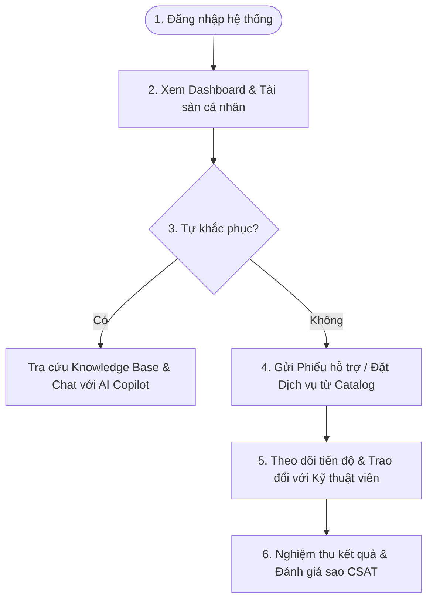
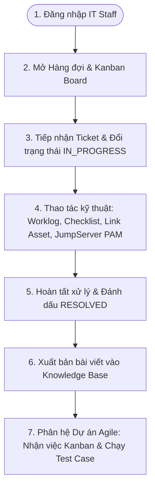
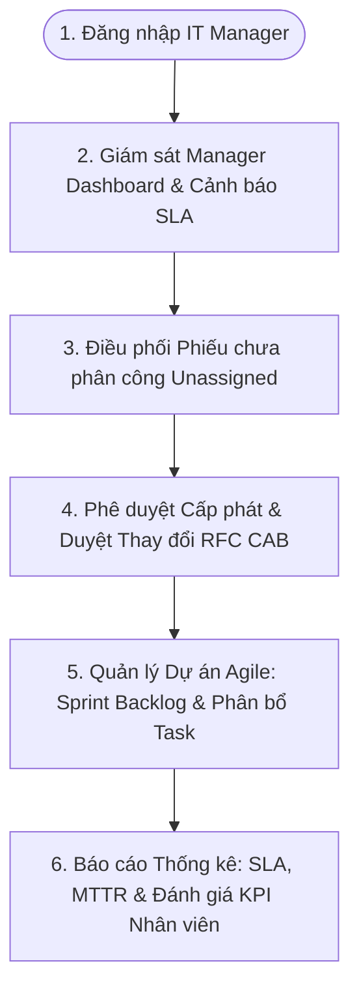
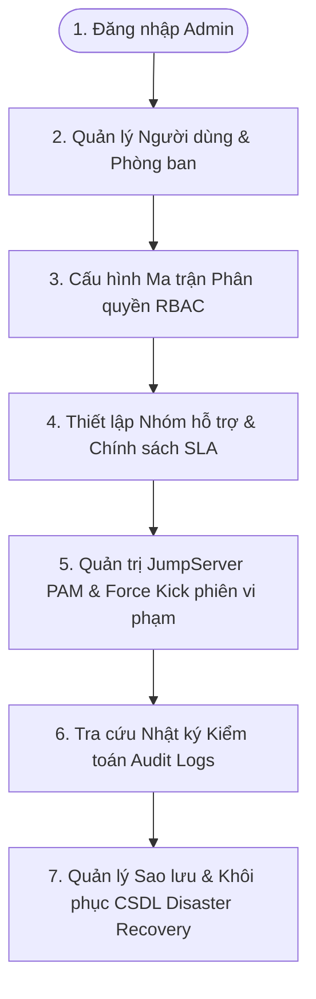

# TÀI LIỆU HƯỚNG DẪN LUỒNG VẬN HÀNH TỪ A ĐẾN Z CỦA TỪNG CẤP NGƯỜI DÙNG
## PHỤC VỤ THUYẾT TRÌNH, DEMO VÀ ĐÀO TẠO HỆ THỐNG TASKFLOW ITSM & AGILE

---

## I. MỤC TIÊU VÀ TỔNG QUAN PHÂN QUYỀN

Tài liệu này được biên soạn nhằm hướng dẫn chi tiết từng bước thao tác (Step-by-step) cho **4 cấp độ người dùng** trong hệ sinh thái phần mềm **TaskFlow ITSM & Agile**. Kịch bản được thiết kế theo trình tự thực tế doanh nghiệp giúp người thuyết trình / giảng viên đào tạo dễ dàng dẫn dắt người xem từ lúc phát sinh nhu cầu đến khi hoàn tất xử lý và nghiệm thu.

### 1. Bảng ma trận tài khoản Demo mẫu

| Cấp độ người dùng | Mã vai trò | Tài khoản mẫu | Mật khẩu mặc định | Mô tả chức trách |
|:---|:---:|:---:|:---:|:---|
| **1. End User** | `USER` | `user1`, `user2`<br>`ketoan_lan`<br>`kinhdoanh_nam` | `123456` | Nhân viên các phòng ban (Kế toán, Kinh doanh, Marketing,...): Gửi yêu cầu hỗ trợ, theo dõi tài sản cá nhân, tra cứu cẩm nang kỹ thuật, đánh giá chất lượng phục vụ. |
| **2. IT Staff** | `IT_STAFF` | `it_helpdesk`<br>`it_network`<br>`it_app` | `123456` | Kỹ thuật viên / Kỹ sư hỗ trợ: Tiếp nhận và xử lý Ticket, ghi nhận nhật ký làm việc (Worklog), quản lý tài sản, kết nối máy chủ qua Web Terminal, thực thi Task/Bug trong dự án Agile. |
| **3. IT Manager** | `IT_MANAGER` | `manager`<br>`it_leader` | `123456` | Trưởng nhóm / Trưởng phòng IT / Quản lý dự án: Phân công công việc, xét duyệt yêu cầu cấp phát, quản lý kế hoạch Sprint/Backlog, giám sát cam kết SLA và đánh giá KPI nhân viên. |
| **4. System Admin**| `ADMIN` | `admin` | `123456` | Quản trị viên hệ thống: Quản lý nhân sự, phân quyền ma trận RBAC, cấu hình nhóm dịch vụ và chính sách SLA, kiểm toán bảo mật (Audit Logs) và sao lưu dữ liệu. |

> **Mẹo demo nhanh:** Tại trang đăng nhập (`http://localhost:3000/login`), người thuyết trình chỉ cần bấm nút **"Xem toàn bộ 37 tài khoản demo"**, chọn vai trò mong muốn và bấm vào tài khoản là hệ thống sẽ tự động điền sẵn tên đăng nhập và mật khẩu.

---

## II. LUỒNG 1: CẤP ĐỘ END USER (NGƯỜI DÙNG DOANH NGHIỆP)

> **Tình huống demo:** Chị Lan (phòng Kế toán - `ketoan_lan`) bị sự cố phần mềm hóa đơn điện tử không mở được và cần yêu cầu cấp thêm một màn hình làm việc phụ.



### Bước 1: Đăng nhập hệ thống
1. Truy cập: `http://localhost:3000/login`
2. Bấm chọn nhanh tài khoản `ketoan_lan` (Nguyễn Thị Hương Lan - Phòng Kế toán) hoặc `user1` (Đỗ Mai Phương), mật khẩu `123456`.
3. Bấm **"Đăng nhập hệ thống"**. Hệ thống tự động chuyển hướng vào Trang tổng quan người dùng.

### Bước 2: Xem Bảng điều khiển cá nhân & Danh mục tài sản đang giữ
1. Truy cập: `http://localhost:3000/dashboard`
   - Quan sát số lượng phiếu yêu cầu đang mở, phiếu đang xử lý và phiếu đã hoàn thành.
2. **Xem thiết bị/tài sản công ty cấp:** Bấm vào **Vòng tròn Avatar góc trên cùng bên phải** ➔ Chọn dòng **"Thiết bị của tôi"** *(hoặc rê chuột vào menu **"Công việc" ➔ "Thiết bị / Tài sản của tôi"**, URL: `http://localhost:3000/my-assets`)*.
   - Kiểm tra các thiết bị máy móc công ty đã bàn giao cho mình (Laptop Dell Latitude / ThinkPad, Màn hình,... kèm số Serial và ngày cấp).

### Bước 3: Tự tra cứu giải pháp bằng Cơ sở tri thức & AI Copilot
1. Truy cập menu **Tiện ích ➔ Cơ sở tri thức (KB)** (URL: `http://localhost:3000/kb`).
2. Nhập từ khóa: *"hóa đơn"* hoặc *"mạng wifi"* vào thanh tìm kiếm.
3. Đọc bài viết hướng dẫn xử lý sự cố nhanh và bấm nút **"Hữu ích" (Upvote)**.
4. Mở cửa sổ **Trợ lý AI Copilot** đặt câu hỏi kỹ thuật để AI đưa ra các bước tự xử lý tại chỗ.

### Bước 4: Gửi Yêu cầu hỗ trợ mới (Create Ticket)
1. Bấm nút màu xanh **"+ Tạo mới"** trên thanh Topbar hoặc vào **Bộ lọc & Phiếu ➔ Gửi yêu cầu mới** (URL: `http://localhost:3000/tickets/create`).
   - *Cách khác:* Vào **Cổng dịch vụ (Service Catalog)** tại `http://localhost:3000/catalog`, bấm chọn danh mục *"Phần mềm ứng dụng & ERP"*.
2. Điền thông tin phiếu hỗ trợ:
   - **Dịch vụ:** Chọn *"Hỗ trợ Phần mềm Kế toán / Hóa đơn"*.
   - **Mức độ ưu tiên:** Chọn `HIGH` (Cao) hoặc `URGENT` (Khẩn cấp).
   - **Tiêu đề tóm tắt:** `Lỗi không ký số được trên hóa đơn điện tử VAT`.
   - **Mô tả chi tiết:** `Khi bấm xuất hóa đơn hệ thống báo lỗi không tìm thấy chứng thư số Token USB. Nhờ IT hỗ trợ gấp vì chuẩn bị đến hạn nộp báo cáo thuế.`
   - **Đính kèm tệp:** Tải lên ảnh chụp màn hình báo lỗi.
3. Bấm **"Gửi phiếu hỗ trợ"**. Hệ thống tạo mã phiếu thành công (ví dụ: `#TICK-2026-064`) và thiết lập đồng hồ SLA.

### Bước 5: Tương tác trao đổi với Kỹ thuật viên IT
1. Mở trang chi tiết phiếu: `http://localhost:3000/tickets/{id}`.
2. Xem thông tin: Kỹ thuật viên nào đang phụ trách, trạng thái hiện tại (`IN_PROGRESS`).
3. Gửi tin nhắn phản hồi, bổ sung thông tin hoặc trả lời câu hỏi của IT ngay trong khung thảo luận.

### Bước 6: Nghiệm thu và Đánh giá chất lượng dịch vụ (CSAT)
1. Khi IT xử lý xong và chuyển trạng thái phiếu sang `RESOLVED` (Đã giải quyết):
   - Người dùng vào lại phiếu, kiểm tra kết quả ghi chú giải pháp của IT.
2. Bấm nút **"Xác nhận đóng phiếu" (Confirm Close)**.
3. Chấm điểm sao hài lòng (**CSAT Rating 1 - 5 Sao**) và gửi lời cảm ơn đánh giá: `Kỹ thuật viên hỗ trợ nhiệt tình, xử lý nhanh chóng trong 15 phút!`.

---

## III. LUỒNG 2: CẤP ĐỘ IT STAFF (KỸ THUẬT VIÊN / CHUYÊN VIÊN IT)

> **Tình huống demo:** Anh Bảo (Kỹ thuật viên Helpdesk - `it_helpdesk`) tiếp nhận phiếu lỗi hóa đơn của chị Lan, chẩn đoán, kết nối máy chủ Bastion PAM kiểm tra dịch vụ và hoàn tất xử lý. Sau đó anh chuyển sang làm việc với Task và Test Case trong dự án Agile TaskFlow.



### Bước 1: Đăng nhập và Mở Hàng đợi công việc
1. Đăng nhập bằng tài khoản: `it_helpdesk`, mật khẩu `123456`.
2. Mở menu: **Công việc ➔ Hàng đợi của tôi (Work Queue)** (URL: `http://localhost:3000/staff/work-queue`).
   - Kiểm tra các thẻ thông số: Số phiếu mới tiếp nhận, phiếu sắp vi phạm thời gian cam kết SLA, phiếu đang tạm dừng.
3. Chuyển sang màn hình **Bảng Kanban Ticket** (`http://localhost:3000/tickets/board`) để có góc nhìn trực quan.

### Bước 2: Tiếp nhận và Chuyển trạng thái xử lý
1. Bấm mở phiếu yêu cầu `#TICK-2026-064` vừa được gửi từ chị Lan.
2. Bấm nút **"Tiếp nhận xử lý" (Take Ticket)** hoặc tự gán cho bản thân. Trạng thái phiếu tự động chuyển từ `NEW` ➔ `ASSIGNED` ➔ `IN_PROGRESS`.
3. Đồng hồ SLA Response dừng lại (đạt chỉ tiêu phản hồi ban đầu), đồng hồ SLA Resolution tiếp tục đếm ngược thời hạn giải quyết sự cố.

### Bước 3: Thực hiện nghiệp vụ chuyên sâu trên Ticket
Tại màn hình chi tiết phiếu (`http://localhost:3000/tickets/{id}`):
1. **Liên kết tài sản gặp lỗi (Link Asset):** Bấm chọn máy tính bàn hoặc USB Token của chị Lan trong danh sách để gắn vào phiếu (giúp theo dõi lịch sử hỏng hóc của thiết bị này).
2. **Theo dõi Danh mục kiểm tra (Checklist):** Đánh dấu tích vào các bước:
   - [x] Kiểm tra cắm lại Token USB vào cổng sau thân máy.
   - [x] Khởi động lại service Token Manager.
   - [ ] Kiểm tra hạn chứng thư số trên hệ thống thuế.
3. **Ghi nhận thời gian xử lý (Worklog):** Nhập số thời gian đã dành để xử lý phiếu (ví dụ: `45 phút`) kèm mô tả công việc.
4. **Kết nối máy chủ kiểm tra an toàn qua Bastion JumpServer PAM:**
   - Vào menu **Phân hệ ➔ Bastion PAM** (`http://localhost:3000/jump`).
   - Bấm **"Mở Web Terminal"** kết nối tới máy chủ `App Server - Billing Service`.
   - Gõ lệnh kiểm tra tiến trình `ps aux`, `systemctl status token-service` ngay trên trình duyệt mà không cần biết mật khẩu root.
5. **Kịch bản Leo thang sự cố (Escalate Tier):**
   - Nếu sự cố vượt quá thẩm quyền cấp 1, kỹ thuật viên bấm **"Leo thang kỹ thuật" (Escalate)** chuyển từ `Tier 1 (Helpdesk)` lên `Tier 2 (System/Network)` hoặc liên kết sang **Quản lý Vấn đề (Problem Management)** nếu đây là lỗi diện rộng.

### Bước 4: Giải quyết sự cố (Resolve Ticket)
1. Sau khi xử lý xong, kỹ thuật viên chọn nút **"Giải quyết sự cố" (Resolve)**.
2. Nhập nội dung biên bản giải pháp: `Đã cập nhật lại Driver USB Token và kích hoạt lại service ký số. Đã in thử hóa đơn số 00124 thành công.`
3. Phiếu chuyển sang trạng thái `RESOLVED`. Hệ thống tự động gửi thông báo tới chuông thông báo của chị Lan.

### Bước 5: Đóng góp tri thức vào Knowledge Base (KEDB)
1. Để tránh các kỹ thuật viên khác mất thời gian khi gặp lỗi tương tự, bấm nút **"Xuất bản sang Knowledge Base"**.
2. Hệ thống tự động điền sẵn tiêu đề và các bước khắc phục sự cố vào form tạo bài viết (`http://localhost:3000/kb/create`). Bấm **"Lưu bài viết"**.

### Bước 6: Làm việc trên Phân hệ Quản lý Dự án Agile (TaskFlow)
1. Mở menu **Dự án ➔ Bảng Kanban Dự án** (`http://localhost:3000/projects/10/board`).
2. Tìm thẻ công việc (Task) được phân công cho mình (ví dụ: `DNA-12: Nâng cấp module hóa đơn`).
3. Dùng chuột **kéo thả** thẻ từ cột `TO DO` sang `IN PROGRESS` rồi sang `IN REVIEW`.
4. Mở tab **Ca kiểm thử (Test Cases)** tại `http://localhost:3000/projects/10/testcases`:
   - Tìm Test Case kiểm thử chức năng ký số, bấm cập nhật kết quả: chuyển từ `UNTESTED` sang `PASSED` (Đạt).

---

## IV. LUỒNG 3: CẤP ĐỘ IT MANAGER (TRƯỞNG PHÒNG IT / QUẢN LÝ DỰ ÁN)

> **Tình huống demo:** Anh Hoàng (IT Manager - `manager`) bắt đầu ngày làm việc bằng việc giám sát bảng điều khiển SLA, điều phối các ticket tồn đọng, phê duyệt yêu cầu cấp phát màn hình mới của phòng Kế toán, và theo dõi tiến độ Sprint dự án phần mềm.



### Bước 1: Giám sát toàn cảnh qua Bảng điều khiển Quản lý
1. Đăng nhập tài khoản: `manager`, mật khẩu `123456`.
2. Mở trang: `http://localhost:3000/manager/dashboard`.
3. Kiểm tra các số liệu quản trị:
   - Tổng số phiếu tiếp nhận trong tuần, số phiếu đang mở.
   - Số phiếu có nguy cơ vi phạm thời gian cam kết SLA (cảnh báo màu đỏ).
   - Tỷ lệ hài lòng của khách hàng (Điểm CSAT trung bình đạt 4.8 / 5.0).
   - Biểu đồ phân bổ công việc theo từng nhóm kỹ thuật (Helpdesk / Network / App).

### Bước 2: Điều phối các phiếu chưa có người nhận (Unassigned Tickets)
1. Vào menu **Công việc ➔ Phiếu chưa phân công** (`http://localhost:3000/tickets/unassigned`).
2. Xem danh sách các yêu cầu mới gửi vào hệ thống nhưng chưa có ai phụ trách.
3. Bấm vào phiếu, chọn nhân viên kỹ thuật phù hợp từ danh sách phân công (Assignee) hoặc chuyển nhóm xử lý chuyên trách (Transfer Group). Kỹ thuật viên được chỉ định sẽ nhận được thông báo tức thì trên góc chuông.

### Bước 3: Trung tâm Phê duyệt & Hội đồng xét duyệt thay đổi (CAB)
1. **Phê duyệt yêu cầu cấp phát tài sản:**
   - Vào menu: **Tiện ích ➔ Trung tâm phê duyệt** (`http://localhost:3000/approvals`).
   - Mở yêu cầu: *"Đề xuất cấp màn hình phụ Dell 24 inch cho chị Lan - Phòng Kế toán"*.
   - Xem xét lý do và ngân sách, bấm nút màu xanh **"Chấp thuận" (Approve)** hoặc màu đỏ **"Từ chối" (Reject)** kèm lý do.
2. **Duyệt Thay đổi hệ thống RFC (Change Advisory Board):**
   - Vào menu: **Công việc ➔ Quản lý Thay đổi (RFC)** (`http://localhost:3000/changes`).
   - Mở phiếu thay đổi hệ thống `#RFC-2026-013` (ví dụ: *"Nâng cấp hệ thống máy chủ cơ sở dữ liệu core lúc 23h00"*).
   - Kiểm tra kế hoạch dự phòng (Rollback Plan) và bấm **"Phê duyệt CAB"**.

### Bước 4: Quản lý Dự án Agile (TaskFlow Workspace)
1. Vào menu **Dự án ➔ Danh sách dự án** (`http://localhost:3000/projects`).
2. **Lập kế hoạch Sprint (Sprint Planning):**
   - Mở màn hình **Backlog** của dự án: `http://localhost:3000/projects/10/backlog`.
   - Xem các hạng mục Story, Task đang nằm trong Product Backlog.
   - Bấm nút chuyển các hạng mục ưu tiên vào **Active Sprint (Sprint 1 - 2026)**.
3. **Theo dõi tiến độ trên Bảng Kanban:**
   - Mở `http://localhost:3000/projects/10/board`.
   - Lọc theo từng thành viên để xem khối lượng công việc (Workload) có bị quá tải không.
   - Theo dõi số lượng Bug phát sinh trên tab **Bugs** (`http://localhost:3000/projects/10/bugs`).

### Bước 5: Xem Báo cáo & Đánh giá Năng suất KPI
1. **Báo cáo Vận hành & SLA:**
   - Mở menu **Báo cáo ➔ Báo cáo dịch vụ IT** (`http://localhost:3000/reports`).
   - Quan sát biểu đồ tỷ lệ tuân thủ cam kết SLA (% đúng hạn), thời gian xử lý trung bình (MTTR).
2. **Báo cáo Đánh giá Kỹ thuật viên (Staff Performance):**
   - Mở menu **Báo cáo ➔ Hiệu suất kỹ thuật viên** (`http://localhost:3000/reports/staff`).
   - Xem bảng xếp hạng nhân viên xuất sắc: Số phiếu đã đóng, tỷ lệ giải quyết đúng hạn, điểm đánh giá sao từ khách hàng.
3. **Xuất báo cáo nghiệm thu:**
   - Bấm nút **"Xuất file Excel"** tại trang Tickets (`http://localhost:3000/tickets/export`) hoặc Báo cáo (`http://localhost:3000/reports/export`) để phục vụ họp ban giám đốc.

---

## V. LUỒNG 4: CẤP ĐỘ ADMIN (QUẢN TRỊ VIÊN HỆ THỐNG)

> **Tình huống demo:** Quản trị viên hệ thống (`admin`) thực hiện cấu hình tài khoản nhân sự mới, thiết lập ma trận phân quyền RBAC chi tiết, cấu hình chính sách SLA, giám sát phiên kết nối JumpServer PAM và thực hiện sao lưu CSDL dự phòng.



### Bước 1: Đăng nhập và Quản trị Người dùng
1. Đăng nhập tài khoản: `admin`, mật khẩu `123456`.
2. Mở menu: **Cài đặt ➔ Quản lý Người dùng** (`http://localhost:3000/admin/users`).
3. Thao tác demo:
   - Bấm **"+ Thêm người dùng mới"**: Nhập họ tên, email, tên đăng nhập, chọn phòng ban (Kế toán / Kinh doanh / IT) và gán vai trò (`IT_STAFF`, `USER`,...).
   - Khóa / Mở khóa tài khoản: Bấm nút Toggle trạng thái để kích hoạt hoặc tạm dừng tài khoản vi phạm chính sách.

### Bước 2: Thiết lập Ma trận Phân quyền Vai trò (RBAC Permissions Matrix)
1. Mở menu: **Cài đặt ➔ Ma trận Phân quyền** (`http://localhost:3000/admin/permissions`).
2. Giới thiệu bảng ma trận: Hàng ngang là danh sách các quyền hạn chi tiết (Menu truy cập, Quyền tạo dự án, Quyền xóa tài sản, Quyền duyệt yêu cầu, Quyền SSH máy chủ, Quyền xuất báo cáo); Cột dọc là 4 vai trò chính.
3. Tích chọn hoặc bỏ tích một quyền hạn (ví dụ: cho phép vai trò `USER` được xem cổng Knowledge Base nhưng không được phép xóa tài sản). Bấm **"Lưu cập nhật ma trận"**.

### Bước 3: Cấu hình Nhóm Kỹ thuật & Cam kết Dịch vụ (SLA Policies)
1. **Cấu hình Nhóm Kỹ thuật:** Mở `http://localhost:3000/admin/groups`. Thiết lập các tổ chuyên trách: `IT Helpdesk`, `IT Network Infrastructure`, `Application & ERP Support`.
2. **Cấu hình SLA:** Mở `http://localhost:3000/admin/sla`.
   - Xem và chỉnh sửa chính sách:
     - Mức độ `URGENT` (Khẩn cấp): Thời gian phản hồi tối đa `15 phút`, thời gian giải quyết tối đa `2 giờ`.
     - Mức độ `HIGH` (Cao): Phản hồi `30 phút`, giải quyết `4 giờ`.
     - Mức độ `MEDIUM` (Bình thường): Phản hồi `2 giờ`, giải quyết `8 giờ`.
     - Chỉ tính trong khung giờ làm việc hành chính (08:00 - 17:30).

### Bước 4: Quản trị Máy chủ Bastion PAM & Cưỡng bức ngắt phiên (Force Kick)
1. Mở menu: **Cài đặt ➔ Quản trị JumpServer PAM** (`http://localhost:3000/admin/jump-servers`).
2. Xem danh sách máy chủ hạ tầng (Linux Web Server, Database Master, Kubernetes Cluster,...).
3. **Phân quyền truy cập:** Chọn máy chủ và cấp quyền cho kỹ sư `it_network` được phép đăng nhập.
4. **Giám sát phiên trực tiếp (Active Sessions):**
   - Quan sát danh sách các kỹ sư đang mở terminal kết nối vào máy chủ trong thời gian thực.
   - Thao tác bảo mật: Bấm nút màu đỏ **"Kick Ngay" (Force Kick)** để lập tức ngắt kết nối cưỡng bức phiên của một kỹ sư đang thực hiện thao tác sai quy định.
5. **Kiểm toán lệnh (Command Logs):** Xem lịch sử toàn bộ các lệnh Shell mà kỹ sư đã gõ trên máy chủ.

### Bước 5: Nhật ký Kiểm toán Hệ thống (Audit Logs)
1. Mở menu: **Cài đặt ➔ Nhật ký Kiểm toán** (`http://localhost:3000/admin/audit-logs`).
2. Quan sát nhật ký bảo mật: Hệ thống tự động ghi nhận mọi sự kiện quan trọng (Ai đăng nhập, ai thay đổi trạng thái ticket, ai phân quyền người dùng, từ địa chỉ IP nào và vào thời điểm nào).
3. Bấm **"Xuất báo cáo kiểm toán CSV"** để bàn giao cho bộ phận kiểm toán an ninh mạng.

### Bước 6: Sao lưu và Khôi phục Dữ liệu (Disaster Recovery & Backup)
1. Mở menu: **Cài đặt ➔ Sao lưu & Khôi phục** (`http://localhost:3000/admin/backups`).
2. Bấm nút **"+ Tạo bản sao lưu ngay"**: Hệ thống tự động trích xuất toàn bộ cấu trúc bảng và dữ liệu thành tệp tin `.sql`.
3. Bấm **"Tải về máy tính"** để lưu trữ bản dự phòng.
4. Giới thiệu chức năng **"Khôi phục dữ liệu" (Restore)**: Giúp khôi phục lại hệ thống nguyên vẹn khi xảy ra sự cố thảm họa máy chủ.

---

## VI. KỊCH BẢN THUYẾT TRÌNH DEMO LIÊN HOÀN (END-TO-END DEMO SCENARIO)

Để buổi thuyết trình đồ án diễn ra liền mạch, chuyên nghiệp trong khoảng thời gian từ **10 đến 15 phút**, người trình bày nên thực hiện một kịch bản liên hoàn mô phỏng chu trình sống trọn vẹn của một yêu cầu công nghệ:

```
[BƯỚC 1: END USER]
Tài khoản: ketoan_lan
Thao tác: Vào Cổng Catalog gửi ticket yêu cầu hỗ trợ lỗi Hóa đơn điện tử khẩn cấp.
Kết quả: Ticket #TICK-064 được tạo, đồng hồ SLA bắt đầu đếm ngược.
       │
       ▼
[BƯỚC 2: IT MANAGER]
Tài khoản: manager
Thao tác: Nhận thông báo trên chuông, vào trang Unassigned điều phối phân công phiếu cho anh Bảo (it_helpdesk).
Kết quả: it_helpdesk nhận được thông báo được giao việc mới.
       │
       ▼
[BƯỚC 3: IT STAFF]
Tài khoản: it_helpdesk
Thao tác: Mở Hàng đợi Work Queue, bấm "Tiếp nhận", ghi nhận Checklist, bật Web Terminal JumpServer kiểm tra dịch vụ và giải quyết xong (Resolved).
Kết quả: Đồng hồ SLA dừng lại ghi nhận đúng hạn, ticket chuyển trạng thái Resolved.
       │
       ▼
[BƯỚC 4: END USER]
Tài khoản: ketoan_lan
Thao tác: Nhận thông báo đã xử lý, vào kiểm tra và bấm "Xác nhận đóng phiếu", chấm điểm đánh giá 5 Sao (CSAT).
Kết quả: Phiếu chuyển sang CLOSED, ghi nhận điểm hài lòng vào báo cáo KPI.
       │
       ▼
[BƯỚC 5: IT MANAGER & ADMIN]
Tài khoản: manager & admin
Thao tác: Mở Báo cáo SLA & Hiệu suất KPI để thấy phiếu vừa đóng đã được tính vào tỷ lệ thành công 100%, sau đó kiểm tra Audit Log và sao lưu CSDL an toàn.
Kết quả: Nghiệm thu toàn diện hệ sinh thái vận hành hoàn hảo!
```

---

## VII. TỔNG KẾT DANH MỤC ĐƯỜNG DẪN TRUY CẬP HỆ THỐNG

| Module chức năng | Đường dẫn URL trên trình duyệt | Cấp quyền truy cập tối thiểu |
|:---|:---|:---:|
| **Trang đăng nhập Three.js** | `http://localhost:3000/login` | Công khai (Public) |
| **Bảng điều khiển Người dùng** | `http://localhost:3000/dashboard` | `USER` |
| **Hồ sơ cá nhân** | `http://localhost:3000/profile` | `USER` |
| **Tài sản cá nhân của tôi** | `http://localhost:3000/my-assets` | `USER` |
| **Cổng Dịch vụ (Service Catalog)** | `http://localhost:3000/catalog` | `USER` |
| **Tạo phiếu hỗ trợ mới** | `http://localhost:3000/tickets/create` | `USER` |
| **Cơ sở tri thức (Knowledge Base)** | `http://localhost:3000/kb` | `USER` |
| **Hàng đợi công việc kỹ thuật viên**| `http://localhost:3000/staff/work-queue` | `IT_STAFF` |
| **Bảng Kanban điều phối Ticket** | `http://localhost:3000/tickets/board` | `IT_STAFF` |
| **Quản lý Tài sản CNTT (ITAM)** | `http://localhost:3000/assets` | `IT_STAFF` |
| **Cổng Web Terminal JumpServer** | `http://localhost:3000/jump` | `IT_STAFF` |
| **Bảng điều khiển Quản lý IT** | `http://localhost:3000/manager/dashboard` | `IT_MANAGER` |
| **Phiếu chưa phân công** | `http://localhost:3000/tickets/unassigned` | `IT_MANAGER` |
| **Trung tâm xét duyệt yêu cầu** | `http://localhost:3000/approvals` | `IT_MANAGER` |
| **Danh mục Dự án Agile (TaskFlow)**| `http://localhost:3000/projects` | `USER` / `IT_STAFF` / `IT_MANAGER` |
| **Báo cáo Vận hành & SLA** | `http://localhost:3000/reports` | `IT_MANAGER` |
| **Đánh giá KPI Nhân viên IT** | `http://localhost:3000/reports/staff` | `IT_MANAGER` |
| **Quản lý Người dùng & Nhân sự** | `http://localhost:3000/admin/users` | `ADMIN` |
| **Ma trận Phân quyền RBAC** | `http://localhost:3000/admin/permissions` | `ADMIN` |
| **Cấu hình Cam kết Dịch vụ SLA** | `http://localhost:3000/admin/sla` | `ADMIN` |
| **Quản trị JumpServer PAM** | `http://localhost:3000/admin/jump-servers` | `ADMIN` |
| **Nhật ký Kiểm toán (Audit Logs)** | `http://localhost:3000/admin/audit-logs` | `ADMIN` |
| **Sao lưu & Khôi phục CSDL** | `http://localhost:3000/admin/backups` | `ADMIN` |
