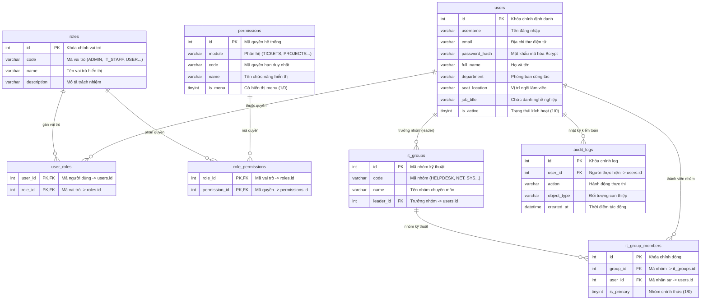
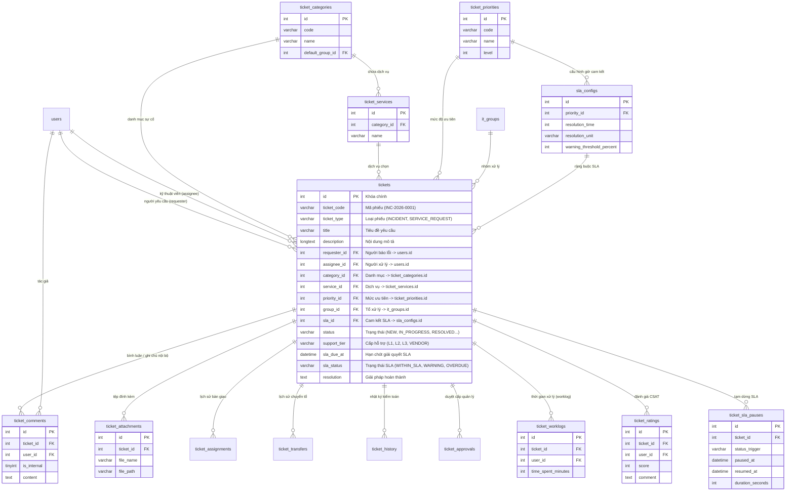
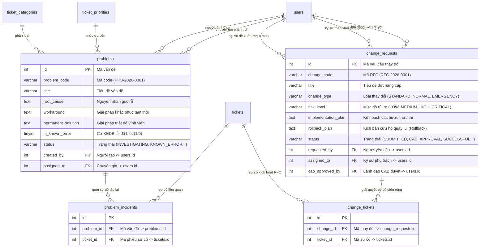
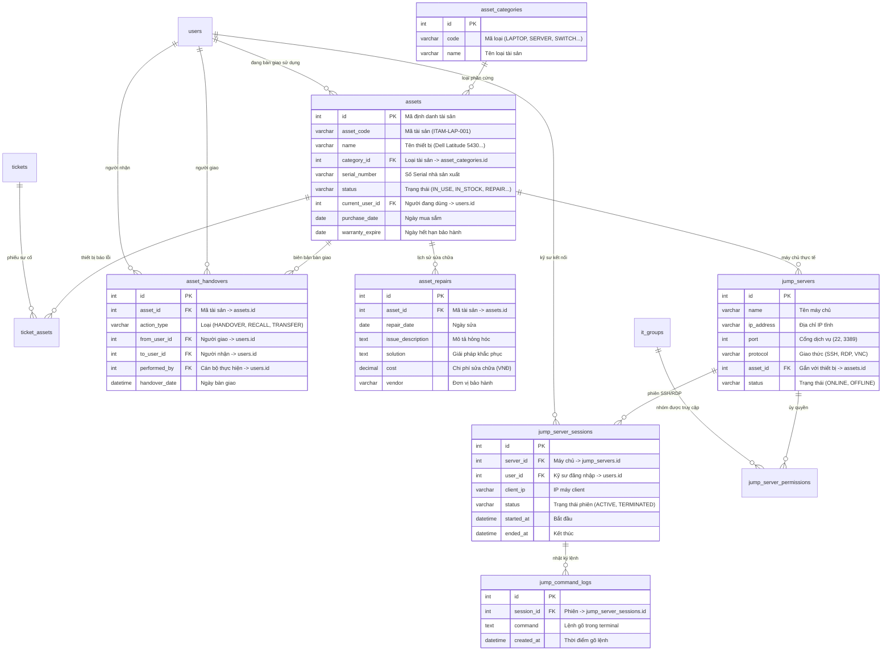
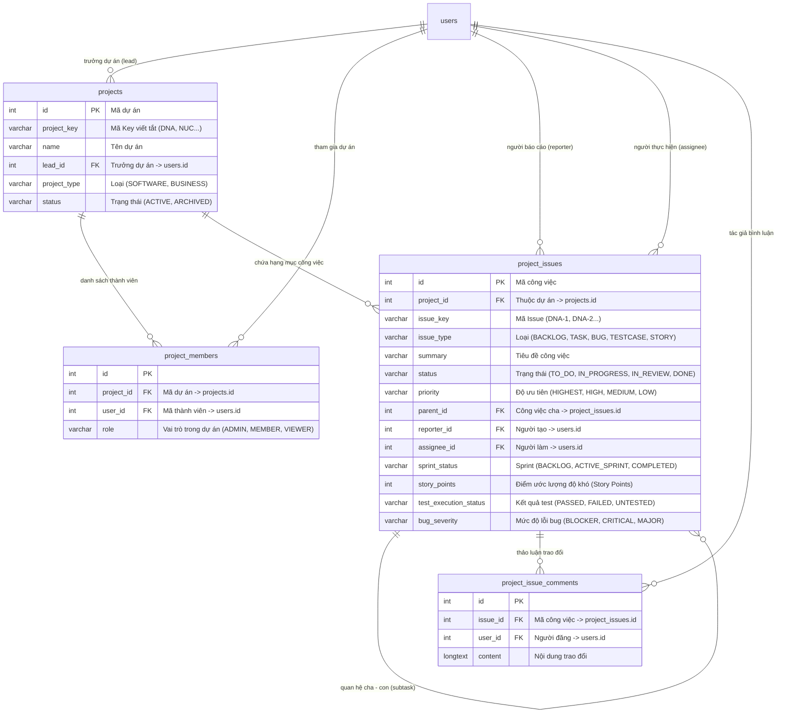
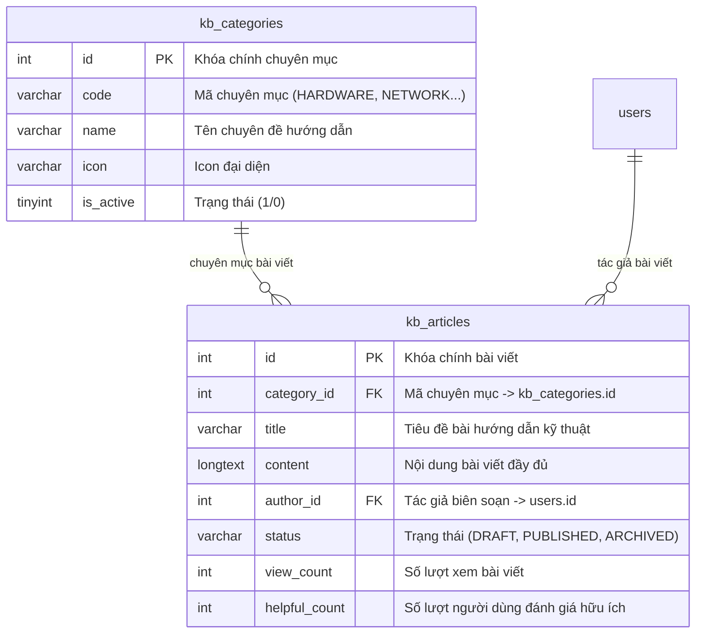

# TÀI LIỆU THIẾT KẾ VÀ ĐẶC TẢ CƠ SỞ DỮ LIỆU HỆ THỐNG
## IT SERVICE DESK & ASSET MANAGEMENT SYSTEM (`it_service_desk`)
*(Phục vụ Thuyết minh Đồ án Tốt nghiệp & Chèn trực tiếp vào Microsoft Word)*

---

# MỤC LỤC
1. [Sơ Đồ Thực Thể Liên Kết Tổng Quan (Master ERD)](#1-sơ-đồ-thực-thể-liên-kết-tổng-quan-master-erd)
2. [Sơ Đồ ERD Chi Tiết Theo Từng Phân Hệ Chức Năng](#2-sơ-đồ-erd-chi-tiết-theo-từng-phân-hệ-chức-năng)
   - [2.1. Phân hệ Tài Khoản, Vai Trò & Phân Quyền (RBAC)](#21-phân-hệ-tài-khoản-vai-trò--phân-quyền-rbac)
   - [2.2. Phân hệ Phiếu Hỗ Trợ & Quy Trình Dịch Vụ (Service Desk & SLA)](#22-phân-hệ-phiếu-hỗ-trợ--quy-trình-dịch-vụ-service-desk--sla)
   - [2.3. Phân hệ Quản Lý Vấn Đề (Problem) & Thay Đổi (Change RFC - ITIL)](#23-phân-hệ-quản-lý-vấn-đề-problem--thay-đổi-change-rfc---itil)
   - [2.4. Phân hệ Tài Sản CNTT (ITAM) & Cổng Máy Chủ Bastion (JumpServer)](#24-phân-hệ-tài-sản-cntt-itam--cổng-máy-chủ-bastion-jumpserver)
   - [2.5. Phân hệ Quản Lý Dự Án Agile & Kiểm Thử (TaskFlow ALM)](#25-phân-hệ-quản-lý-dự-án-agile--kiểm-thử-taskflow-alm)
   - [2.6. Phân hệ Cơ Sở Tri Thức (Knowledge Base)](#26-phân-hệ-cơ-sở-tri-thức-knowledge-base)
3. [Bảng Ma Trận Ánh Xạ Khóa Ngoại (Foreign Key Relationship Matrix)](#3-bảng-ma-trận-ánh-xạ-khóa-ngoại-foreign-key-relationship-matrix)
4. [Từ Điển Dữ Liệu Chi Tiết Các Bảng (Data Dictionary)](#4-từ-điển-dữ-liệu-chi-tiết-các-bảng-data-dictionary)

---

# 1. SƠ ĐỒ THỰC THỂ LIÊN KẾT TỔNG QUAN (MASTER ERD)

```mermaid
erDiagram
    %% RBAC
    roles ||--o{ user_roles : "has"
    users ||--o{ user_roles : "belongs"
    roles ||--o{ role_permissions : "grants"
    permissions ||--o{ role_permissions : "maps"
    users ||--o{ it_group_members : "joins"
    it_groups ||--o{ it_group_members : "contains"
    users ||--o{ it_groups : "leads"

    %% TICKETS CORE
    users ||--o{ tickets : "requester"
    users ||--o{ tickets : "assignee"
    ticket_categories ||--o{ tickets : "categorizes"
    ticket_services ||--o{ tickets : "specifies"
    ticket_priorities ||--o{ tickets : "prioritizes"
    it_groups ||--o{ tickets : "dispatches"
    sla_configs ||--o{ tickets : "binds_sla"
    ticket_categories ||--o{ ticket_services : "contains"
    ticket_priorities ||--o{ sla_configs : "defines_sla"
    tickets ||--o{ tickets : "duplicates"

    %% TICKET ACTIVITIES
    tickets ||--o{ ticket_comments : "has"
    users ||--o{ ticket_comments : "authors"
    tickets ||--o{ ticket_attachments : "attaches"
    users ||--o{ ticket_attachments : "uploads"
    tickets ||--o{ ticket_assignments : "assign_hist"
    tickets ||--o{ ticket_transfers : "transfer_hist"
    tickets ||--o{ ticket_history : "audit_trail"
    tickets ||--o{ ticket_approvals : "approvals"
    tickets ||--o{ ticket_worklogs : "effort_logs"
    tickets ||--o{ ticket_ratings : "csat_rating"
    tickets ||--o{ ticket_sla_pauses : "sla_pauses"
    tickets ||--o{ ticket_links : "relates_to"

    %% ITIL
    problems ||--o{ problem_incidents : "groups"
    tickets ||--o{ problem_incidents : "caused_by"
    change_requests ||--o{ change_tickets : "solves"
    tickets ||--o{ change_tickets : "triggers_rfc"

    %% ITAM & JUMPSERVER
    asset_categories ||--o{ assets : "classifies"
    users ||--o{ assets : "holds"
    assets ||--o{ ticket_assets : "involved"
    tickets ||--o{ ticket_assets : "links"
    assets ||--o{ asset_handovers : "handovers"
    assets ||--o{ asset_repairs : "repairs"
    assets ||--o{ jump_servers : "hosts_bastion"
    jump_servers ||--o{ jump_server_sessions : "sessions"
    jump_server_sessions ||--o{ jump_command_logs : "commands"
    jump_servers ||--o{ jump_server_permissions : "permissions"

    %% TASKFLOW AGILE
    users ||--o{ projects : "leads"
    projects ||--o{ project_members : "members"
    users ||--o{ project_members : "participates"
    projects ||--o{ project_issues : "issues"
    users ||--o{ project_issues : "reports"
    users ||--o{ project_issues : "assigned"
    project_issues ||--o{ project_issues : "parent_subtask"
    project_issues ||--o{ project_issue_comments : "comments"

    %% KNOWLEDGE BASE
    kb_categories ||--o{ kb_articles : "categorizes"
    users ||--o{ kb_articles : "authors"
    users ||--o{ audit_logs : "acts"
    users ||--o{ notifications : "receives"
```

---

# 2. SƠ ĐỒ ERD CHI TIẾT THEO TỪNG PHÂN HỆ CHỨC NĂNG

### 2.1. Phân hệ Tài Khoản, Vai Trò & Phân Quyền (RBAC)

---

### 2.2. Phân hệ Phiếu Hỗ Trợ & Quy Trình Dịch Vụ (Service Desk & SLA)

---

### 2.3. Phân hệ Quản Lý Vấn Đề (Problem) & Thay Đổi (Change RFC - ITIL)

---

### 2.4. Phân hệ Tài Sản CNTT (ITAM) & Cổng Máy Chủ Bastion (JumpServer)

---

### 2.5. Phân hệ Quản Lý Dự Án Agile & Kiểm Thử (TaskFlow ALM)

---

### 2.6. Phân hệ Cơ Sở Tri Thức (Knowledge Base)

---

# 3. BẢNG MA TRẬN ÁNH XẠ KHÓA NGOẠI (FOREIGN KEY RELATIONSHIP MATRIX)

| STT | Bảng Cha (PK) | Bảng Con (FK) | Cột Khóa Ngoại | Bản Số | Ý Nghĩa Ràng Buộc Nghiệp Vụ |
| :---: | :--- | :--- | :--- | :---: | :--- |
| **1** | `roles (id)` | `user_roles (role_id)` | `role_id` | 1 - N | Một vai trò được cấp cho nhiều tài khoản |
| **2** | `users (id)` | `user_roles (user_id)` | `user_id` | 1 - N | Một người dùng có thể sở hữu nhiều vai trò |
| **3** | `roles (id)` | `role_permissions (role_id)` | `role_id` | 1 - N | Một vai trò được cấp nhiều quyền chức năng |
| **4** | `permissions (id)` | `role_permissions (permission_id)` | `permission_id` | 1 - N | Một quyền hạn có thể gán cho nhiều vai trò |
| **5** | `users (id)` | `it_groups (leader_id)` | `leader_id` | 1 - N | Nhân sự IT làm Trưởng nhóm kỹ thuật |
| **6** | `it_groups (id)` | `it_group_members (group_id)` | `group_id` | 1 - N | Nhóm kỹ thuật quy tụ nhiều thành viên IT |
| **7** | `users (id)` | `tickets (requester_id)` | `requester_id` | 1 - N | Người dùng nội bộ gửi nhiều phiếu hỗ trợ |
| **8** | `users (id)` | `tickets (assignee_id)` | `assignee_id` | 1 - N | Kỹ thuật viên IT tiếp nhận xử lý nhiều phiếu |
| **9** | `ticket_categories (id)` | `tickets (category_id)` | `category_id` | 1 - N | Phân loại phiếu theo danh mục sự cố |
| **10** | `ticket_services (id)` | `tickets (service_id)` | `service_id` | 1 - N | Phiếu chọn dịch vụ cụ thể trong Service Catalog |
| **11** | `ticket_priorities (id)` | `tickets (priority_id)` | `priority_id` | 1 - N | Xác định mức độ ưu tiên giải quyết của phiếu |
| **12** | `it_groups (id)` | `tickets (group_id)` | `group_id` | 1 - N | Phân bổ phiếu cho nhóm kỹ thuật phụ trách |
| **13** | `sla_configs (id)` | `tickets (sla_id)` | `sla_id` | 1 - N | Ràng buộc thời hạn cam kết giờ giải quyết SLA |
| **14** | `assets (id)` | `tickets (asset_id)` | `asset_id` | 1 - N | Gắn thiết bị phần cứng phát sinh sự cố vào phiếu |
| **15** | `tickets (id)` | `tickets (duplicate_of_id)` | `duplicate_of_id` | 1 - N | Đánh dấu sự cố trùng lặp với một phiếu gốc |
| **16** | `ticket_categories (id)` | `ticket_services (category_id)` | `category_id` | 1 - N | Danh mục cha chứa danh mục dịch vụ con |
| **17** | `ticket_priorities (id)` | `sla_configs (priority_id)` | `priority_id` | 1 - 1 | Mức ưu tiên quy định chỉ tiêu thời gian SLA |
| **18** | `tickets (id)` | `ticket_comments (ticket_id)` | `ticket_id` | 1 - N | Lưu trữ các phản hồi, bình luận và nội bộ |
| **19** | `tickets (id)` | `ticket_attachments (ticket_id)` | `ticket_id` | 1 - N | Quản lý tài liệu đính kèm, ảnh chụp màn hình |
| **20** | `tickets (id)` | `ticket_assignments (ticket_id)` | `ticket_id` | 1 - N | Lưu vết lịch sử phân công người thực hiện |
| **21** | `tickets (id)` | `ticket_transfers (ticket_id)` | `ticket_id` | 1 - N | Lưu vết lịch sử điều chuyển giữa các nhóm IT |
| **22** | `tickets (id)` | `ticket_history (ticket_id)` | `ticket_id` | 1 - N | Kiểm toán thay đổi trạng thái và dữ liệu phiếu |
| **23** | `tickets (id)` | `ticket_approvals (ticket_id)` | `ticket_id` | 1 - N | Lưu các bước xét duyệt của cấp Trưởng phòng |
| **24** | `tickets (id)` | `ticket_worklogs (ticket_id)` | `ticket_id` | 1 - N | Ghi nhận thời gian thực tế kỹ thuật viên xử lý |
| **25** | `tickets (id)` | `ticket_ratings (ticket_id)` | `ticket_id` | 1 - 1 | Một phiếu nhận một đánh giá chất lượng CSAT |
| **26** | `tickets (id)` | `ticket_sla_pauses (ticket_id)` | `ticket_id` | 1 - N | Ghi nhận các khoảng dừng đồng hồ cam kết SLA |
| **27** | `problems (id)` | `problem_incidents (problem_id)` | `problem_id` | 1 - N | Gom nhiều phiếu sự cố vào bản ghi Vấn đề ITIL |
| **28** | `change_requests (id)` | `change_tickets (change_id)` | `change_id` | 1 - N | Yêu cầu thay đổi RFC giải quyết các sự cố |
| **29** | `asset_categories (id)` | `assets (category_id)` | `category_id` | 1 - N | Loại tài sản phân nhóm các trang thiết bị |
| **30** | `users (id)` | `assets (current_user_id)` | `current_user_id` | 1 - N | Cán bộ nhân viên đang trực tiếp dùng thiết bị |
| **31** | `assets (id)` | `asset_handovers (asset_id)` | `asset_id` | 1 - N | Lịch sử bàn giao, điều chuyển tài sản |
| **32** | `assets (id)` | `asset_repairs (asset_id)` | `asset_id` | 1 - N | Lịch sử bảo hành, sửa chữa, thay linh kiện |
| **33** | `assets (id)` | `jump_servers (asset_id)` | `asset_id` | 1 - 1 | Máy chủ vật lý kết nối vào cổng Bastion PAM |
| **34** | `jump_servers (id)` | `jump_server_sessions (server_id)`| `server_id` | 1 - N | Các phiên đăng nhập điều khiển từ xa SSH/RDP |
| **35** | `jump_server_sessions (id)`| `jump_command_logs (session_id)`| `session_id` | 1 - N | Lưu từng câu lệnh thực thi trong Terminal |
| **36** | `users (id)` | `projects (lead_id)` | `lead_id` | 1 - N | Nhân sự IT đóng vai trò Trưởng dự án |
| **37** | `projects (id)` | `project_members (project_id)` | `project_id` | 1 - N | Quản lý danh sách thành viên trong dự án |
| **38** | `projects (id)` | `project_issues (project_id)` | `project_id` | 1 - N | Dự án chứa các hạng mục công việc, bug, test |
| **39** | `project_issues (id)`| `project_issues (parent_id)` | `parent_id` | 1 - N | Mối quan hệ phân cấp việc Cha - Con (Subtask) |
| **40** | `kb_categories (id)` | `kb_articles (category_id)` | `category_id` | 1 - N | Chuyên mục cẩm nang tri thức chứa bài viết |

---

# 4. TỪ ĐIỂN DỮ LIỆU CHI TIẾT TOÀN BỘ 46 BẢNG (DATA DICTIONARY)

### 4.1. Bảng `asset_categories`

| STT | Tên Cột | Kiểu Dữ Liệu | Khóa | Ràng Buộc | Ý Nghĩa / Quy Định Dữ Liệu |
| :---: | :--- | :--- | :---: | :---: | :--- |
| 1 | `id` | `INT(11)` | **PK** | NOT NULL, Auto Inc | Khóa chính duy nhất (Auto Increment) |
| 2 | `code` | `VARCHAR(50)` | **UNI** | NOT NULL | Mã ký hiệu viết tắt duy nhất |
| 3 | `name` | `VARCHAR(100)` |  | NOT NULL | Tên gọi định danh |
| 4 | `description` | `VARCHAR(255)` |  | NULL | Nội dung mô tả chi tiết |
| 5 | `icon` | `VARCHAR(50)` |  | NULL, Def: bi-laptop | Biểu tượng giao diện (Bootstrap Icon class) |
| 6 | `is_active` | `TINYINT(1)` |  | NULL, Def: 1 | Cờ kích hoạt (1: Hoạt động, 0: Khóa/Ẩn) |
| 7 | `created_at` | `DATETIME` |  | NULL, Def: current_timestamp() | Thời điểm tạo bản ghi |

---

### 4.2. Bảng `asset_handovers`

| STT | Tên Cột | Kiểu Dữ Liệu | Khóa | Ràng Buộc | Ý Nghĩa / Quy Định Dữ Liệu |
| :---: | :--- | :--- | :---: | :---: | :--- |
| 1 | `id` | `INT(11)` | **PK** | NOT NULL, Auto Inc | Khóa chính duy nhất (Auto Increment) |
| 2 | `asset_id` | `INT(11)` | **FK** | NOT NULL | Khóa ngoại liên kết $\rightarrow$ `assets(id)` |
| 3 | `action_type` | `ENUM('HANDOVER','RECALL','TRANSFER','DISPOSAL','STATUS_CHANGE')` |  | NOT NULL | Hình thức luân chuyển: HANDOVER, RECALL, TRANSFER, DISPOSAL |
| 4 | `from_user_id` | `INT(11)` | **FK** | NULL | Khóa ngoại liên kết $\rightarrow$ `users(id)` |
| 5 | `to_user_id` | `INT(11)` | **FK** | NULL | Khóa ngoại liên kết $\rightarrow$ `users(id)` |
| 6 | `from_location` | `VARCHAR(150)` |  | NULL | Vị trí xuất phát bàn giao |
| 7 | `to_location` | `VARCHAR(150)` |  | NULL | Vị trí đích tiếp nhận |
| 8 | `reason` | `VARCHAR(255)` |  | NULL | Lý do bàn giao / thu hồi thiết bị |
| 9 | `performed_by` | `INT(11)` | **FK** | NOT NULL | Khóa ngoại liên kết $\rightarrow$ `users(id)` |
| 10 | `handover_date` | `DATETIME` |  | NULL, Def: current_timestamp() | Ngày giờ thực hiện bàn giao |

---

### 4.3. Bảng `asset_repairs`

| STT | Tên Cột | Kiểu Dữ Liệu | Khóa | Ràng Buộc | Ý Nghĩa / Quy Định Dữ Liệu |
| :---: | :--- | :--- | :---: | :---: | :--- |
| 1 | `id` | `INT(11)` | **PK** | NOT NULL, Auto Inc | Khóa chính duy nhất (Auto Increment) |
| 2 | `asset_id` | `INT(11)` | **FK** | NOT NULL | Khóa ngoại liên kết $\rightarrow$ `assets(id)` |
| 3 | `repair_date` | `DATE` |  | NOT NULL | Ngày đưa thiết bị đi sửa chữa |
| 4 | `issue_description` | `TEXT` |  | NOT NULL | Mô tả hư hỏng phần cứng |
| 5 | `root_cause` | `TEXT` |  | NULL | Trường thông tin root_cause |
| 6 | `solution` | `TEXT` |  | NULL | Trường thông tin solution |
| 7 | `replaced_parts` | `TEXT` |  | NULL | Danh mục linh kiện được thay thế |
| 8 | `cost` | `DECIMAL(15,2)` |  | NULL, Def: 0.00 | Chi phí sửa chữa (VNĐ) |
| 9 | `vendor` | `VARCHAR(150)` |  | NULL | Đơn vị / Trung tâm bảo hành sửa chữa |
| 10 | `performed_by` | `INT(11)` | **FK** | NOT NULL | Khóa ngoại liên kết $\rightarrow$ `users(id)` |
| 11 | `notes` | `TEXT` |  | NULL | Ghi chú bổ sung |
| 12 | `created_at` | `DATETIME` |  | NULL, Def: current_timestamp() | Thời điểm tạo bản ghi |

---

### 4.4. Bảng `assets`

| STT | Tên Cột | Kiểu Dữ Liệu | Khóa | Ràng Buộc | Ý Nghĩa / Quy Định Dữ Liệu |
| :---: | :--- | :--- | :---: | :---: | :--- |
| 1 | `id` | `INT(11)` | **PK** | NOT NULL, Auto Inc | Khóa chính duy nhất (Auto Increment) |
| 2 | `asset_code` | `VARCHAR(50)` | **UNI** | NOT NULL | Mã định danh quản lý tài sản (ITAM-LAP-001...) |
| 3 | `name` | `VARCHAR(150)` |  | NOT NULL | Tên gọi định danh |
| 4 | `category_id` | `INT(11)` | **FK** | NOT NULL | Khóa ngoại liên kết $\rightarrow$ `asset_categories(id)` |
| 5 | `manufacturer` | `VARCHAR(100)` |  | NULL | Hãng sản xuất thiết bị (Dell, HP, Cisco...) |
| 6 | `model` | `VARCHAR(100)` |  | NULL | Dòng model thiết bị |
| 7 | `serial_number` | `VARCHAR(100)` |  | NULL | Số Serial Number do nhà sản xuất phát hành |
| 8 | `purchase_date` | `DATE` |  | NULL | Ngày mua sắm trang bị |
| 9 | `warranty_expire` | `DATE` |  | NULL | Ngày hết hạn bảo hành chính hãng |
| 10 | `status` | `ENUM('IN_STOCK','IN_USE','REPAIR','LOST','DAMAGED','LIQUIDATED','DISPOSED')` |  | NULL, Def: IN_STOCK | Trạng thái nghiệp vụ của bản ghi |
| 11 | `department` | `VARCHAR(100)` |  | NULL | Trường thông tin department |
| 12 | `location` | `VARCHAR(150)` |  | NULL | Vị trí hiện tại đặt thiết bị (Phòng, Kho) |
| 13 | `current_user_id` | `INT(11)` | **FK** | NULL | Khóa ngoại liên kết $\rightarrow$ `users(id)` |
| 14 | `specifications` | `TEXT` |  | NULL | Thông số cấu hình kỹ thuật (CPU, RAM, Ổ cứng...) |
| 15 | `notes` | `TEXT` |  | NULL | Ghi chú bổ sung |
| 16 | `created_at` | `DATETIME` |  | NULL, Def: current_timestamp() | Thời điểm tạo bản ghi |
| 17 | `updated_at` | `DATETIME` |  | NULL, Def: current_timestamp() | Thời điểm cập nhật bản ghi gần nhất |

---

### 4.5. Bảng `audit_logs`

| STT | Tên Cột | Kiểu Dữ Liệu | Khóa | Ràng Buộc | Ý Nghĩa / Quy Định Dữ Liệu |
| :---: | :--- | :--- | :---: | :---: | :--- |
| 1 | `id` | `INT(11)` | **PK** | NOT NULL, Auto Inc | Khóa chính duy nhất (Auto Increment) |
| 2 | `user_id` | `INT(11)` | **FK** | NULL | Khóa ngoại liên kết $\rightarrow$ `users(id)` |
| 3 | `action` | `VARCHAR(100)` |  | NOT NULL | Trường thông tin action |
| 4 | `object_type` | `VARCHAR(50)` |  | NOT NULL | Trường thông tin object_type |
| 5 | `object_id` | `INT(11)` |  | NULL | Trường thông tin object_id |
| 6 | `old_value` | `LONGTEXT` |  | NULL | Trường thông tin old_value |
| 7 | `new_value` | `LONGTEXT` |  | NULL | Trường thông tin new_value |
| 8 | `reason` | `VARCHAR(255)` |  | NULL | Trường thông tin reason |
| 9 | `ip_address` | `VARCHAR(45)` |  | NULL | Trường thông tin ip_address |
| 10 | `user_agent` | `VARCHAR(255)` |  | NULL | Trường thông tin user_agent |
| 11 | `created_at` | `DATETIME` |  | NULL, Def: current_timestamp() | Thời điểm tạo bản ghi |

---

### 4.6. Bảng `change_requests`

| STT | Tên Cột | Kiểu Dữ Liệu | Khóa | Ràng Buộc | Ý Nghĩa / Quy Định Dữ Liệu |
| :---: | :--- | :--- | :---: | :---: | :--- |
| 1 | `id` | `INT(11)` | **PK** | NOT NULL, Auto Inc | Khóa chính duy nhất (Auto Increment) |
| 2 | `change_code` | `VARCHAR(30)` | **UNI** | NOT NULL | Mã phiếu đề xuất thay đổi RFC (RFC-2026-0001...) |
| 3 | `title` | `VARCHAR(255)` |  | NOT NULL | Tiêu đề |
| 4 | `description` | `TEXT` |  | NOT NULL | Nội dung mô tả chi tiết |
| 5 | `reason` | `TEXT` |  | NOT NULL | Lý do cần thiết phải thực hiện thay đổi |
| 6 | `change_type` | `ENUM('STANDARD','NORMAL','EMERGENCY')` |  | NOT NULL, Def: NORMAL | Phân loại: STANDARD (Chuẩn), NORMAL (Thường), EMERGENCY (Khẩn) |
| 7 | `risk_level` | `ENUM('LOW','MEDIUM','HIGH','CRITICAL')` |  | NOT NULL, Def: MEDIUM | Đánh giá rủi ro: LOW, MEDIUM, HIGH, CRITICAL |
| 8 | `environment_stage` | `ENUM('DEV','TEST','MIG_UAT','RELEASE_PROD')` |  | NOT NULL, Def: DEV | Giai đoạn môi trường: DEV, TEST, MIG_UAT, RELEASE_PROD |
| 9 | `status` | `ENUM('DRAFT','SUBMITTED','CAB_APPROVAL','SCHEDULED','IMPLEMENTING','TESTING_UAT','RELEASE_PROD','SUCCESSFUL','FAILED','ROLLED_BACK','CANCELLED')` |  | NOT NULL, Def: DRAFT | Trạng thái nghiệp vụ của bản ghi |
| 10 | `implementation_plan` | `TEXT` |  | NULL | Phương án từng bước triển khai kỹ thuật |
| 11 | `rollback_plan` | `TEXT` |  | NULL | Kế hoạch cứu hộ quay lui (Rollback) khi xảy ra sự cố |
| 12 | `test_plan` | `TEXT` |  | NULL | Kế hoạch kiểm thử nghiệm thu sau thay đổi |
| 13 | `scheduled_start` | `DATETIME` |  | NULL | Thời gian dự kiến bắt đầu triển khai |
| 14 | `scheduled_end` | `DATETIME` |  | NULL | Thời gian dự kiến hoàn thành |
| 15 | `actual_start` | `DATETIME` |  | NULL | Thời gian thực tế bắt đầu |
| 16 | `actual_end` | `DATETIME` |  | NULL | Thời gian thực tế kết thúc |
| 17 | `requested_by` | `INT(11)` | **FK** | NOT NULL | Khóa ngoại liên kết $\rightarrow$ `users(id)` |
| 18 | `assigned_to` | `INT(11)` | **FK** | NULL | Khóa ngoại liên kết $\rightarrow$ `users(id)` |
| 19 | `cab_approved_by` | `INT(11)` | **FK** | NULL | Khóa ngoại liên kết $\rightarrow$ `users(id)` |
| 20 | `cab_approved_at` | `DATETIME` |  | NULL | Thời điểm đại diện hội đồng CAB phê duyệt |
| 21 | `cab_note` | `TEXT` |  | NULL | Ý kiến kết luận của hội đồng CAB |
| 22 | `created_at` | `DATETIME` |  | NULL, Def: current_timestamp() | Thời điểm tạo bản ghi |
| 23 | `updated_at` | `DATETIME` |  | NULL, Def: current_timestamp() | Thời điểm cập nhật bản ghi gần nhất |

---

### 4.7. Bảng `change_tickets`

| STT | Tên Cột | Kiểu Dữ Liệu | Khóa | Ràng Buộc | Ý Nghĩa / Quy Định Dữ Liệu |
| :---: | :--- | :--- | :---: | :---: | :--- |
| 1 | `id` | `INT(11)` | **PK** | NOT NULL, Auto Inc | Khóa chính duy nhất (Auto Increment) |
| 2 | `change_id` | `INT(11)` | **FK** | NOT NULL | Khóa ngoại liên kết $\rightarrow$ `change_requests(id)` |
| 3 | `ticket_id` | `INT(11)` | **FK** | NOT NULL | Khóa ngoại liên kết $\rightarrow$ `tickets(id)` |
| 4 | `created_at` | `DATETIME` |  | NULL, Def: current_timestamp() | Thời điểm tạo bản ghi |

---

### 4.8. Bảng `it_group_members`

| STT | Tên Cột | Kiểu Dữ Liệu | Khóa | Ràng Buộc | Ý Nghĩa / Quy Định Dữ Liệu |
| :---: | :--- | :--- | :---: | :---: | :--- |
| 1 | `id` | `INT(11)` | **PK** | NOT NULL, Auto Inc | Khóa chính duy nhất (Auto Increment) |
| 2 | `group_id` | `INT(11)` | **FK** | NOT NULL | Khóa ngoại liên kết $\rightarrow$ `it_groups(id)` |
| 3 | `user_id` | `INT(11)` | **FK** | NOT NULL | Khóa ngoại liên kết $\rightarrow$ `users(id)` |
| 4 | `is_primary` | `TINYINT(1)` |  | NULL, Def: 1 | Trường thông tin is_primary |
| 5 | `created_at` | `DATETIME` |  | NULL, Def: current_timestamp() | Thời điểm tạo bản ghi |

---

### 4.9. Bảng `it_groups`

| STT | Tên Cột | Kiểu Dữ Liệu | Khóa | Ràng Buộc | Ý Nghĩa / Quy Định Dữ Liệu |
| :---: | :--- | :--- | :---: | :---: | :--- |
| 1 | `id` | `INT(11)` | **PK** | NOT NULL, Auto Inc | Khóa chính duy nhất (Auto Increment) |
| 2 | `code` | `VARCHAR(50)` | **UNI** | NOT NULL | Mã ký hiệu viết tắt duy nhất |
| 3 | `name` | `VARCHAR(100)` |  | NOT NULL | Tên gọi định danh |
| 4 | `description` | `VARCHAR(255)` |  | NULL | Nội dung mô tả chi tiết |
| 5 | `leader_id` | `INT(11)` | **FK** | NULL | Khóa ngoại liên kết $\rightarrow$ `users(id)` |
| 6 | `is_active` | `TINYINT(1)` |  | NULL, Def: 1 | Cờ kích hoạt (1: Hoạt động, 0: Khóa/Ẩn) |
| 7 | `created_at` | `DATETIME` |  | NULL, Def: current_timestamp() | Thời điểm tạo bản ghi |

---

### 4.10. Bảng `jump_command_logs`

| STT | Tên Cột | Kiểu Dữ Liệu | Khóa | Ràng Buộc | Ý Nghĩa / Quy Định Dữ Liệu |
| :---: | :--- | :--- | :---: | :---: | :--- |
| 1 | `id` | `INT(11)` | **PK** | NOT NULL, Auto Inc | Khóa chính duy nhất (Auto Increment) |
| 2 | `session_id` | `INT(11)` | **FK** | NOT NULL | Khóa ngoại liên kết $\rightarrow$ `jump_server_sessions(id)` |
| 3 | `server_id` | `INT(11)` |  | NOT NULL | Trường thông tin server_id |
| 4 | `user_id` | `INT(11)` |  | NOT NULL | Mã người dùng liên quan |
| 5 | `command` | `TEXT` |  | NOT NULL | Chuỗi câu lệnh do kỹ sư thực thi trên Terminal |
| 6 | `created_at` | `DATETIME` |  | NULL, Def: current_timestamp() | Thời điểm tạo bản ghi |

---

### 4.11. Bảng `jump_server_permissions`

| STT | Tên Cột | Kiểu Dữ Liệu | Khóa | Ràng Buộc | Ý Nghĩa / Quy Định Dữ Liệu |
| :---: | :--- | :--- | :---: | :---: | :--- |
| 1 | `id` | `INT(11)` | **PK** | NOT NULL, Auto Inc | Khóa chính duy nhất (Auto Increment) |
| 2 | `server_id` | `INT(11)` | **FK** | NOT NULL | Khóa ngoại liên kết $\rightarrow$ `jump_servers(id)` |
| 3 | `user_id` | `INT(11)` | **FK** | NULL | Khóa ngoại liên kết $\rightarrow$ `users(id)` |
| 4 | `group_id` | `INT(11)` | **FK** | NULL | Khóa ngoại liên kết $\rightarrow$ `it_groups(id)` |
| 5 | `granted_by` | `INT(11)` |  | NOT NULL | Trường thông tin granted_by |
| 6 | `created_at` | `DATETIME` |  | NULL, Def: current_timestamp() | Thời điểm tạo bản ghi |

---

### 4.12. Bảng `jump_server_sessions`

| STT | Tên Cột | Kiểu Dữ Liệu | Khóa | Ràng Buộc | Ý Nghĩa / Quy Định Dữ Liệu |
| :---: | :--- | :--- | :---: | :---: | :--- |
| 1 | `id` | `INT(11)` | **PK** | NOT NULL, Auto Inc | Khóa chính duy nhất (Auto Increment) |
| 2 | `session_token` | `VARCHAR(64)` | **UNI** | NOT NULL | Mã token định danh phiên kết nối Web Terminal |
| 3 | `server_id` | `INT(11)` | **FK** | NOT NULL | Khóa ngoại liên kết $\rightarrow$ `jump_servers(id)` |
| 4 | `user_id` | `INT(11)` | **FK** | NOT NULL | Khóa ngoại liên kết $\rightarrow$ `users(id)` |
| 5 | `client_ip` | `VARCHAR(50)` |  | NULL | Địa chỉ IP của người dùng thực hiện truy cập |
| 6 | `status` | `ENUM('ACTIVE','KICKED','TERMINATED')` |  | NOT NULL, Def: ACTIVE | Trạng thái nghiệp vụ của bản ghi |
| 7 | `started_at` | `DATETIME` |  | NULL, Def: current_timestamp() | Thời điểm bắt đầu phiên kết nối |
| 8 | `ended_at` | `DATETIME` |  | NULL | Thời điểm kết thúc phiên kết nối |
| 9 | `last_heartbeat_at` | `DATETIME` |  | NULL, Def: current_timestamp() | Thời điểm gửi tín hiệu duy trì (Keep-alive) gần nhất |
| 10 | `kicked_by_user_id` | `INT(11)` | **FK** | NULL | Khóa ngoại liên kết $\rightarrow$ `users(id)` |

---

### 4.13. Bảng `jump_servers`

| STT | Tên Cột | Kiểu Dữ Liệu | Khóa | Ràng Buộc | Ý Nghĩa / Quy Định Dữ Liệu |
| :---: | :--- | :--- | :---: | :---: | :--- |
| 1 | `id` | `INT(11)` | **PK** | NOT NULL, Auto Inc | Khóa chính duy nhất (Auto Increment) |
| 2 | `name` | `VARCHAR(100)` |  | NOT NULL | Tên gọi định danh |
| 3 | `ip_address` | `VARCHAR(50)` |  | NOT NULL | Địa chỉ IP tĩnh của máy chủ |
| 4 | `port` | `INT(11)` |  | NOT NULL, Def: 22 | Cổng kết nối dịch vụ (22: SSH, 3389: RDP...) |
| 5 | `protocol` | `ENUM('SSH','RDP','VNC','TELNET')` |  | NOT NULL, Def: SSH | Giao thức điều khiển: SSH, RDP, VNC, TELNET |
| 6 | `os_type` | `ENUM('LINUX','UBUNTU','CENTOS','WINDOWS','DEBIAN')` |  | NOT NULL, Def: LINUX | Hệ điều hành: LINUX, UBUNTU, CENTOS, WINDOWS, DEBIAN |
| 7 | `default_username` | `VARCHAR(50)` |  | NOT NULL, Def: root | Tên tài khoản mặc định truy cập máy chủ |
| 8 | `description` | `VARCHAR(255)` |  | NULL | Nội dung mô tả chi tiết |
| 9 | `asset_id` | `INT(11)` | **FK** | NULL | Khóa ngoại liên kết $\rightarrow$ `assets(id)` |
| 10 | `status` | `ENUM('ONLINE','OFFLINE','MAINTENANCE')` |  | NOT NULL, Def: ONLINE | Trạng thái nghiệp vụ của bản ghi |
| 11 | `is_active` | `TINYINT(1)` |  | NULL, Def: 1 | Cờ kích hoạt (1: Hoạt động, 0: Khóa/Ẩn) |
| 12 | `created_at` | `DATETIME` |  | NULL, Def: current_timestamp() | Thời điểm tạo bản ghi |

---

### 4.14. Bảng `kb_articles`

| STT | Tên Cột | Kiểu Dữ Liệu | Khóa | Ràng Buộc | Ý Nghĩa / Quy Định Dữ Liệu |
| :---: | :--- | :--- | :---: | :---: | :--- |
| 1 | `id` | `INT(11)` | **PK** | NOT NULL, Auto Inc | Khóa chính duy nhất (Auto Increment) |
| 2 | `category_id` | `INT(11)` | **FK** | NOT NULL | Khóa ngoại liên kết $\rightarrow$ `kb_categories(id)` |
| 3 | `title` | `VARCHAR(255)` |  | NOT NULL | Tiêu đề |
| 4 | `content` | `LONGTEXT` |  | NOT NULL | Nội dung văn bản chi tiết |
| 5 | `author_id` | `INT(11)` | **FK** | NOT NULL | Khóa ngoại liên kết $\rightarrow$ `users(id)` |
| 6 | `status` | `ENUM('DRAFT','PUBLISHED','ARCHIVED')` |  | NULL, Def: PUBLISHED | Trạng thái nghiệp vụ của bản ghi |
| 7 | `view_count` | `INT(11)` |  | NULL, Def: 0 | Trường thông tin view_count |
| 8 | `helpful_count` | `INT(11)` |  | NULL, Def: 0 | Trường thông tin helpful_count |
| 9 | `unhelpful_count` | `INT(11)` |  | NULL, Def: 0 | Trường thông tin unhelpful_count |
| 10 | `created_at` | `DATETIME` |  | NULL, Def: current_timestamp() | Thời điểm tạo bản ghi |
| 11 | `updated_at` | `DATETIME` |  | NULL, Def: current_timestamp() | Thời điểm cập nhật bản ghi gần nhất |

---

### 4.15. Bảng `kb_categories`

| STT | Tên Cột | Kiểu Dữ Liệu | Khóa | Ràng Buộc | Ý Nghĩa / Quy Định Dữ Liệu |
| :---: | :--- | :--- | :---: | :---: | :--- |
| 1 | `id` | `INT(11)` | **PK** | NOT NULL, Auto Inc | Khóa chính duy nhất (Auto Increment) |
| 2 | `code` | `VARCHAR(50)` | **UNI** | NOT NULL | Mã ký hiệu viết tắt duy nhất |
| 3 | `name` | `VARCHAR(100)` |  | NOT NULL | Tên gọi định danh |
| 4 | `description` | `VARCHAR(255)` |  | NULL | Nội dung mô tả chi tiết |
| 5 | `icon` | `VARCHAR(50)` |  | NULL, Def: bi-book | Biểu tượng giao diện (Bootstrap Icon class) |
| 6 | `is_active` | `TINYINT(1)` |  | NULL, Def: 1 | Cờ kích hoạt (1: Hoạt động, 0: Khóa/Ẩn) |
| 7 | `created_at` | `DATETIME` |  | NULL, Def: current_timestamp() | Thời điểm tạo bản ghi |

---

### 4.16. Bảng `notifications`

| STT | Tên Cột | Kiểu Dữ Liệu | Khóa | Ràng Buộc | Ý Nghĩa / Quy Định Dữ Liệu |
| :---: | :--- | :--- | :---: | :---: | :--- |
| 1 | `id` | `INT(11)` | **PK** | NOT NULL, Auto Inc | Khóa chính duy nhất (Auto Increment) |
| 2 | `user_id` | `INT(11)` | **FK** | NOT NULL | Khóa ngoại liên kết $\rightarrow$ `users(id)` |
| 3 | `ticket_id` | `INT(11)` | **FK** | NULL | Khóa ngoại liên kết $\rightarrow$ `tickets(id)` |
| 4 | `title` | `VARCHAR(255)` |  | NOT NULL | Tiêu đề |
| 5 | `message` | `TEXT` |  | NOT NULL | Trường thông tin message |
| 6 | `type` | `VARCHAR(50)` |  | NULL, Def: info | Trường thông tin type |
| 7 | `is_read` | `TINYINT(1)` |  | NULL, Def: 0 | Trường thông tin is_read |
| 8 | `created_at` | `DATETIME` |  | NULL, Def: current_timestamp() | Thời điểm tạo bản ghi |

---

### 4.17. Bảng `permissions`

| STT | Tên Cột | Kiểu Dữ Liệu | Khóa | Ràng Buộc | Ý Nghĩa / Quy Định Dữ Liệu |
| :---: | :--- | :--- | :---: | :---: | :--- |
| 1 | `id` | `INT(11)` | **PK** | NOT NULL, Auto Inc | Khóa chính duy nhất (Auto Increment) |
| 2 | `module` | `VARCHAR(50)` |  | NOT NULL | Phân hệ chức năng (TICKETS, PROJECTS, ASSETS...) |
| 3 | `code` | `VARCHAR(100)` | **UNI** | NOT NULL | Mã ký hiệu viết tắt duy nhất |
| 4 | `name` | `VARCHAR(150)` |  | NOT NULL | Tên gọi định danh |
| 5 | `description` | `VARCHAR(255)` |  | NULL | Nội dung mô tả chi tiết |
| 6 | `is_menu` | `TINYINT(1)` |  | NULL, Def: 0 | Cờ hiển thị trên thanh Menu điều hướng (1: Có, 0: Không) |
| 7 | `sort_order` | `INT(11)` |  | NULL, Def: 0 | Thứ tự sắp xếp hiển thị |
| 8 | `created_at` | `DATETIME` |  | NULL, Def: current_timestamp() | Thời điểm tạo bản ghi |

---

### 4.18. Bảng `problem_incidents`

| STT | Tên Cột | Kiểu Dữ Liệu | Khóa | Ràng Buộc | Ý Nghĩa / Quy Định Dữ Liệu |
| :---: | :--- | :--- | :---: | :---: | :--- |
| 1 | `id` | `INT(11)` | **PK** | NOT NULL, Auto Inc | Khóa chính duy nhất (Auto Increment) |
| 2 | `problem_id` | `INT(11)` | **FK** | NOT NULL | Khóa ngoại liên kết $\rightarrow$ `problems(id)` |
| 3 | `ticket_id` | `INT(11)` | **FK** | NOT NULL | Khóa ngoại liên kết $\rightarrow$ `tickets(id)` |
| 4 | `created_at` | `DATETIME` |  | NULL, Def: current_timestamp() | Thời điểm tạo bản ghi |

---

### 4.19. Bảng `problems`

| STT | Tên Cột | Kiểu Dữ Liệu | Khóa | Ràng Buộc | Ý Nghĩa / Quy Định Dữ Liệu |
| :---: | :--- | :--- | :---: | :---: | :--- |
| 1 | `id` | `INT(11)` | **PK** | NOT NULL, Auto Inc | Khóa chính duy nhất (Auto Increment) |
| 2 | `problem_code` | `VARCHAR(30)` | **UNI** | NOT NULL | Mã hồ sơ vấn đề ITIL (PRB-2026-0001...) |
| 3 | `title` | `VARCHAR(255)` |  | NOT NULL | Tiêu đề |
| 4 | `description` | `TEXT` |  | NOT NULL | Nội dung mô tả chi tiết |
| 5 | `category_id` | `INT(11)` | **FK** | NOT NULL | Khóa ngoại liên kết $\rightarrow$ `ticket_categories(id)` |
| 6 | `priority_id` | `INT(11)` | **FK** | NOT NULL | Khóa ngoại liên kết $\rightarrow$ `ticket_priorities(id)` |
| 7 | `status` | `ENUM('LOGGED','INVESTIGATING','WORKAROUND_FOUND','KNOWN_ERROR','RESOLVED','CLOSED')` |  | NOT NULL, Def: LOGGED | Trạng thái nghiệp vụ của bản ghi |
| 8 | `root_cause` | `TEXT` |  | NULL | Trường thông tin root_cause |
| 9 | `workaround` | `TEXT` |  | NULL | Giải pháp khắc phục tạm thời cho người dùng (Workaround) |
| 10 | `permanent_solution` | `TEXT` |  | NULL | Giải pháp khắc phục dứt điểm tận gốc |
| 11 | `is_known_error` | `TINYINT(1)` |  | NULL, Def: 0 | Cờ đánh dấu đưa vào KEDB (Known Error Database) |
| 12 | `assigned_to` | `INT(11)` | **FK** | NULL | Khóa ngoại liên kết $\rightarrow$ `users(id)` |
| 13 | `created_by` | `INT(11)` | **FK** | NOT NULL | Khóa ngoại liên kết $\rightarrow$ `users(id)` |
| 14 | `resolved_at` | `DATETIME` |  | NULL | Thời điểm giải quyết xong vấn đề |
| 15 | `created_at` | `DATETIME` |  | NULL, Def: current_timestamp() | Thời điểm tạo bản ghi |
| 16 | `updated_at` | `DATETIME` |  | NULL, Def: current_timestamp() | Thời điểm cập nhật bản ghi gần nhất |

---

### 4.20. Bảng `project_issue_comments`

| STT | Tên Cột | Kiểu Dữ Liệu | Khóa | Ràng Buộc | Ý Nghĩa / Quy Định Dữ Liệu |
| :---: | :--- | :--- | :---: | :---: | :--- |
| 1 | `id` | `INT(11)` | **PK** | NOT NULL, Auto Inc | Khóa chính duy nhất (Auto Increment) |
| 2 | `issue_id` | `INT(11)` | **FK** | NOT NULL | Khóa ngoại liên kết $\rightarrow$ `project_issues(id)` |
| 3 | `user_id` | `INT(11)` | **FK** | NOT NULL | Khóa ngoại liên kết $\rightarrow$ `users(id)` |
| 4 | `content` | `LONGTEXT` |  | NOT NULL | Nội dung văn bản chi tiết |
| 5 | `created_at` | `DATETIME` |  | NULL, Def: current_timestamp() | Thời điểm tạo bản ghi |

---

### 4.21. Bảng `project_issues`

| STT | Tên Cột | Kiểu Dữ Liệu | Khóa | Ràng Buộc | Ý Nghĩa / Quy Định Dữ Liệu |
| :---: | :--- | :--- | :---: | :---: | :--- |
| 1 | `id` | `INT(11)` | **PK** | NOT NULL, Auto Inc | Khóa chính duy nhất (Auto Increment) |
| 2 | `project_id` | `INT(11)` | **FK** | NOT NULL | Khóa ngoại liên kết $\rightarrow$ `projects(id)` |
| 3 | `issue_key` | `VARCHAR(30)` | **UNI** | NOT NULL | Mã định danh công việc (DNA-1, DNA-2...) |
| 4 | `issue_number` | `INT(11)` |  | NOT NULL | Số thứ tự tăng dần của issue trong dự án |
| 5 | `issue_type` | `ENUM('BACKLOG','TASK','BUG','TESTCASE','STORY','EPIC')` |  | NOT NULL, Def: TASK | Loại: BACKLOG, TASK, BUG, TESTCASE, STORY, EPIC |
| 6 | `summary` | `VARCHAR(255)` |  | NOT NULL | Trường thông tin summary |
| 7 | `description` | `LONGTEXT` |  | NULL | Nội dung mô tả chi tiết |
| 8 | `status` | `ENUM('TO_DO','IN_PROGRESS','IN_REVIEW','DONE')` |  | NOT NULL, Def: TO_DO | Trạng thái nghiệp vụ của bản ghi |
| 9 | `priority` | `ENUM('HIGHEST','HIGH','MEDIUM','LOW','LOWEST')` |  | NOT NULL, Def: MEDIUM | Trường thông tin priority |
| 10 | `reporter_id` | `INT(11)` | **FK** | NOT NULL | Khóa ngoại liên kết $\rightarrow$ `users(id)` |
| 11 | `assignee_id` | `INT(11)` | **FK** | NULL | Khóa ngoại liên kết $\rightarrow$ `users(id)` |
| 12 | `sprint_status` | `ENUM('BACKLOG','ACTIVE_SPRINT','COMPLETED')` |  | NOT NULL, Def: ACTIVE_SPRINT | Kỳ Sprint: BACKLOG, ACTIVE_SPRINT, COMPLETED |
| 13 | `component` | `VARCHAR(50)` |  | NULL | Mô-đun thành phần liên quan (BILLING, ACCOUNTS, SECURITY...) |
| 14 | `story_points` | `INT(11)` |  | NULL, Def: 1 | Điểm độ phức tạp ước lượng Agile (Story Points) |
| 15 | `epic_id` | `INT(11)` |  | NULL | Trường thông tin epic_id |
| 16 | `test_type` | `ENUM('MANUAL','AUTOMATED','REGRESSION','SMOKE')` |  | NULL, Def: MANUAL | Loại kiểm thử: MANUAL, AUTOMATED, REGRESSION, SMOKE |
| 17 | `test_steps` | `TEXT` |  | NULL | Các bước thực hiện kiểm thử |
| 18 | `test_expected_result` | `TEXT` |  | NULL | Kết quả mong đợi khi kiểm thử |
| 19 | `test_execution_status` | `ENUM('UNTESTED','PASSED','FAILED','BLOCKED')` |  | NULL, Def: UNTESTED | Trạng thái chạy test: UNTESTED, PASSED, FAILED, BLOCKED |
| 20 | `bug_severity` | `ENUM('BLOCKER','CRITICAL','MAJOR','MINOR','TRIVIAL')` |  | NULL, Def: MAJOR | Mức độ nghiêm trọng của Bug: BLOCKER, CRITICAL, MAJOR, MINOR, TRIVIAL |
| 21 | `steps_to_reproduce` | `TEXT` |  | NULL | Các bước tái hiện lỗi phần mềm |
| 22 | `actual_result` | `TEXT` |  | NULL | Kết quả thực tế bị lỗi |
| 23 | `expected_result` | `TEXT` |  | NULL | Kết quả đúng theo thiết kế ban đầu |
| 24 | `environment` | `VARCHAR(255)` |  | NULL | Môi trường phát sinh lỗi (Staging, Production, Win 11, Chrome...) |
| 25 | `sort_order` | `INT(11)` |  | NULL, Def: 0 | Thứ tự sắp xếp hiển thị |
| 26 | `created_at` | `DATETIME` |  | NULL, Def: current_timestamp() | Thời điểm tạo bản ghi |
| 27 | `updated_at` | `DATETIME` |  | NULL, Def: current_timestamp() | Thời điểm cập nhật bản ghi gần nhất |
| 28 | `parent_id` | `INT(11)` | **FK** | NULL | Khóa ngoại liên kết $\rightarrow$ `project_issues(id)` |
| 29 | `notes` | `LONGTEXT` |  | NULL | Ghi chú bổ sung |
| 30 | `original_estimate_hours` | `DECIMAL(6,2)` |  | NULL, Def: 0.00 | Thời gian ước tính ban đầu (Giờ) |
| 31 | `remaining_hours` | `DECIMAL(6,2)` |  | NULL, Def: 0.00 | Thời gian còn lại cần để hoàn thành (Giờ) |
| 32 | `completed_hours` | `DECIMAL(6,2)` |  | NULL, Def: 0.00 | Thời gian thực tế đã hoàn thành (Giờ) |
| 33 | `start_date` | `DATE` |  | NULL | Ngày bắt đầu thực hiện |
| 34 | `due_date` | `DATE` |  | NULL | Hạn chót phải hoàn thành |
| 35 | `risks` | `TEXT` |  | NULL | Đánh giá các rủi ro kỹ thuật |
| 36 | `tags` | `VARCHAR(255)` |  | NULL | Thẻ tag phân loại công việc |
| 37 | `area` | `VARCHAR(100)` |  | NULL, Def: Main/Core | Trường thông tin area |
| 38 | `iteration` | `VARCHAR(100)` |  | NULL, Def: Sprint 1 (2026) | Trường thông tin iteration |

---

### 4.22. Bảng `project_members`

| STT | Tên Cột | Kiểu Dữ Liệu | Khóa | Ràng Buộc | Ý Nghĩa / Quy Định Dữ Liệu |
| :---: | :--- | :--- | :---: | :---: | :--- |
| 1 | `id` | `INT(11)` | **PK** | NOT NULL, Auto Inc | Khóa chính duy nhất (Auto Increment) |
| 2 | `project_id` | `INT(11)` | **FK** | NOT NULL | Khóa ngoại liên kết $\rightarrow$ `projects(id)` |
| 3 | `user_id` | `INT(11)` | **FK** | NOT NULL | Khóa ngoại liên kết $\rightarrow$ `users(id)` |
| 4 | `role` | `ENUM('ADMIN','MEMBER','VIEWER')` |  | NOT NULL, Def: MEMBER | Vai trò trong dự án: ADMIN (Quản trị), MEMBER (Thành viên), VIEWER (Xem) |
| 5 | `created_at` | `DATETIME` |  | NULL, Def: current_timestamp() | Thời điểm tạo bản ghi |

---

### 4.23. Bảng `projects`

| STT | Tên Cột | Kiểu Dữ Liệu | Khóa | Ràng Buộc | Ý Nghĩa / Quy Định Dữ Liệu |
| :---: | :--- | :--- | :---: | :---: | :--- |
| 1 | `id` | `INT(11)` | **PK** | NOT NULL, Auto Inc | Khóa chính duy nhất (Auto Increment) |
| 2 | `project_key` | `VARCHAR(10)` | **UNI** | NOT NULL | Mã Key viết tắt đại diện dự án (DNA, NUC, PRJ...) |
| 3 | `name` | `VARCHAR(150)` |  | NOT NULL | Tên gọi định danh |
| 4 | `description` | `TEXT` |  | NULL | Nội dung mô tả chi tiết |
| 5 | `project_type` | `ENUM('SOFTWARE','BUSINESS','SERVICE_DESK')` |  | NOT NULL, Def: SOFTWARE | Loại dự án: SOFTWARE (Phần mềm), BUSINESS, SERVICE_DESK |
| 6 | `lead_id` | `INT(11)` | **FK** | NOT NULL | Khóa ngoại liên kết $\rightarrow$ `users(id)` |
| 7 | `avatar_icon` | `VARCHAR(50)` |  | NOT NULL, Def: bi-rocket-takeoff-fill | Icon đại diện dự án |
| 8 | `avatar_bg` | `VARCHAR(20)` |  | NOT NULL, Def: #6554C0 | Mã màu nền cho avatar dự án |
| 9 | `status` | `ENUM('ACTIVE','ARCHIVED')` |  | NOT NULL, Def: ACTIVE | Trạng thái nghiệp vụ của bản ghi |
| 10 | `created_at` | `DATETIME` |  | NULL, Def: current_timestamp() | Thời điểm tạo bản ghi |
| 11 | `updated_at` | `DATETIME` |  | NULL, Def: current_timestamp() | Thời điểm cập nhật bản ghi gần nhất |

---

### 4.24. Bảng `role_permissions`

| STT | Tên Cột | Kiểu Dữ Liệu | Khóa | Ràng Buộc | Ý Nghĩa / Quy Định Dữ Liệu |
| :---: | :--- | :--- | :---: | :---: | :--- |
| 1 | `role_id` | `INT(11)` | **PK** | NOT NULL | Khóa ngoại liên kết $\rightarrow$ `roles(id)` |
| 2 | `permission_id` | `INT(11)` | **PK** | NOT NULL | Khóa ngoại liên kết $\rightarrow$ `permissions(id)` |

---

### 4.25. Bảng `roles`

| STT | Tên Cột | Kiểu Dữ Liệu | Khóa | Ràng Buộc | Ý Nghĩa / Quy Định Dữ Liệu |
| :---: | :--- | :--- | :---: | :---: | :--- |
| 1 | `id` | `INT(11)` | **PK** | NOT NULL, Auto Inc | Khóa chính duy nhất (Auto Increment) |
| 2 | `code` | `VARCHAR(50)` | **UNI** | NOT NULL | Mã ký hiệu viết tắt duy nhất |
| 3 | `name` | `VARCHAR(100)` |  | NOT NULL | Tên gọi định danh |
| 4 | `description` | `VARCHAR(255)` |  | NULL | Nội dung mô tả chi tiết |
| 5 | `created_at` | `DATETIME` |  | NULL, Def: current_timestamp() | Thời điểm tạo bản ghi |

---

### 4.26. Bảng `sla_configs`

| STT | Tên Cột | Kiểu Dữ Liệu | Khóa | Ràng Buộc | Ý Nghĩa / Quy Định Dữ Liệu |
| :---: | :--- | :--- | :---: | :---: | :--- |
| 1 | `id` | `INT(11)` | **PK** | NOT NULL, Auto Inc | Khóa chính duy nhất (Auto Increment) |
| 2 | `priority_id` | `INT(11)` | **FK** | NOT NULL | Khóa ngoại liên kết $\rightarrow$ `ticket_priorities(id)` |
| 3 | `name` | `VARCHAR(100)` |  | NOT NULL | Tên gọi định danh |
| 4 | `resolution_time` | `INT(11)` |  | NOT NULL | Thời lượng giải quyết cam kết |
| 5 | `resolution_unit` | `ENUM('HOUR','DAY')` |  | NOT NULL, Def: HOUR | Đơn vị tính: HOUR (Giờ), DAY (Ngày) |
| 6 | `warning_threshold_percent` | `INT(11)` |  | NOT NULL, Def: 70 | Ngưỡng cảnh báo vàng (% thời gian trôi qua) |
| 7 | `critical_threshold_percent` | `INT(11)` |  | NOT NULL, Def: 90 | Ngưỡng báo động đỏ (% thời gian) |
| 8 | `is_active` | `TINYINT(1)` |  | NULL, Def: 1 | Cờ kích hoạt (1: Hoạt động, 0: Khóa/Ẩn) |
| 9 | `created_at` | `DATETIME` |  | NULL, Def: current_timestamp() | Thời điểm tạo bản ghi |

---

### 4.27. Bảng `ticket_approvals`

| STT | Tên Cột | Kiểu Dữ Liệu | Khóa | Ràng Buộc | Ý Nghĩa / Quy Định Dữ Liệu |
| :---: | :--- | :--- | :---: | :---: | :--- |
| 1 | `id` | `INT(11)` | **PK** | NOT NULL, Auto Inc | Khóa chính duy nhất (Auto Increment) |
| 2 | `ticket_id` | `INT(11)` | **FK** | NULL | Khóa ngoại liên kết $\rightarrow$ `tickets(id)` |
| 3 | `change_id` | `INT(11)` |  | NULL | Trường thông tin change_id |
| 4 | `approver_id` | `INT(11)` | **FK** | NOT NULL | Khóa ngoại liên kết $\rightarrow$ `users(id)` |
| 5 | `step_name` | `VARCHAR(100)` |  | NOT NULL, Def: Quản lý phê duyệt | Trường thông tin step_name |
| 6 | `status` | `ENUM('PENDING','APPROVED','REJECTED','RETURNED')` |  | NOT NULL, Def: PENDING | Trạng thái nghiệp vụ của bản ghi |
| 7 | `comment` | `TEXT` |  | NULL | Trường thông tin comment |
| 8 | `decided_at` | `DATETIME` |  | NULL | Trường thông tin decided_at |
| 9 | `created_at` | `DATETIME` |  | NULL, Def: current_timestamp() | Thời điểm tạo bản ghi |

---

### 4.28. Bảng `ticket_assets`

| STT | Tên Cột | Kiểu Dữ Liệu | Khóa | Ràng Buộc | Ý Nghĩa / Quy Định Dữ Liệu |
| :---: | :--- | :--- | :---: | :---: | :--- |
| 1 | `id` | `INT(11)` | **PK** | NOT NULL, Auto Inc | Khóa chính duy nhất (Auto Increment) |
| 2 | `ticket_id` | `INT(11)` | **FK** | NOT NULL | Khóa ngoại liên kết $\rightarrow$ `tickets(id)` |
| 3 | `asset_id` | `INT(11)` | **FK** | NOT NULL | Khóa ngoại liên kết $\rightarrow$ `assets(id)` |
| 4 | `created_at` | `DATETIME` |  | NULL, Def: current_timestamp() | Thời điểm tạo bản ghi |

---

### 4.29. Bảng `ticket_assignments`

| STT | Tên Cột | Kiểu Dữ Liệu | Khóa | Ràng Buộc | Ý Nghĩa / Quy Định Dữ Liệu |
| :---: | :--- | :--- | :---: | :---: | :--- |
| 1 | `id` | `INT(11)` | **PK** | NOT NULL, Auto Inc | Khóa chính duy nhất (Auto Increment) |
| 2 | `ticket_id` | `INT(11)` | **FK** | NOT NULL | Khóa ngoại liên kết $\rightarrow$ `tickets(id)` |
| 3 | `from_user_id` | `INT(11)` | **FK** | NULL | Khóa ngoại liên kết $\rightarrow$ `users(id)` |
| 4 | `to_user_id` | `INT(11)` | **FK** | NOT NULL | Khóa ngoại liên kết $\rightarrow$ `users(id)` |
| 5 | `assigned_by_user_id` | `INT(11)` | **FK** | NOT NULL | Khóa ngoại liên kết $\rightarrow$ `users(id)` |
| 6 | `reason` | `VARCHAR(255)` |  | NULL | Trường thông tin reason |
| 7 | `created_at` | `DATETIME` |  | NULL, Def: current_timestamp() | Thời điểm tạo bản ghi |

---

### 4.30. Bảng `ticket_attachments`

| STT | Tên Cột | Kiểu Dữ Liệu | Khóa | Ràng Buộc | Ý Nghĩa / Quy Định Dữ Liệu |
| :---: | :--- | :--- | :---: | :---: | :--- |
| 1 | `id` | `INT(11)` | **PK** | NOT NULL, Auto Inc | Khóa chính duy nhất (Auto Increment) |
| 2 | `ticket_id` | `INT(11)` | **FK** | NOT NULL | Khóa ngoại liên kết $\rightarrow$ `tickets(id)` |
| 3 | `comment_id` | `INT(11)` | **FK** | NULL | Khóa ngoại liên kết $\rightarrow$ `ticket_comments(id)` |
| 4 | `file_name` | `VARCHAR(255)` |  | NOT NULL | Trường thông tin file_name |
| 5 | `file_path` | `VARCHAR(255)` |  | NOT NULL | Trường thông tin file_path |
| 6 | `file_size` | `INT(11)` |  | NOT NULL | Trường thông tin file_size |
| 7 | `mime_type` | `VARCHAR(100)` |  | NOT NULL | Trường thông tin mime_type |
| 8 | `uploaded_by` | `INT(11)` | **FK** | NOT NULL | Khóa ngoại liên kết $\rightarrow$ `users(id)` |
| 9 | `created_at` | `DATETIME` |  | NULL, Def: current_timestamp() | Thời điểm tạo bản ghi |

---

### 4.31. Bảng `ticket_categories`

| STT | Tên Cột | Kiểu Dữ Liệu | Khóa | Ràng Buộc | Ý Nghĩa / Quy Định Dữ Liệu |
| :---: | :--- | :--- | :---: | :---: | :--- |
| 1 | `id` | `INT(11)` | **PK** | NOT NULL, Auto Inc | Khóa chính duy nhất (Auto Increment) |
| 2 | `code` | `VARCHAR(50)` | **UNI** | NOT NULL | Mã ký hiệu viết tắt duy nhất |
| 3 | `name` | `VARCHAR(100)` |  | NOT NULL | Tên gọi định danh |
| 4 | `description` | `VARCHAR(255)` |  | NULL | Nội dung mô tả chi tiết |
| 5 | `default_group_id` | `INT(11)` | **FK** | NULL | Khóa ngoại liên kết $\rightarrow$ `it_groups(id)` |
| 6 | `is_active` | `TINYINT(1)` |  | NULL, Def: 1 | Cờ kích hoạt (1: Hoạt động, 0: Khóa/Ẩn) |
| 7 | `created_at` | `DATETIME` |  | NULL, Def: current_timestamp() | Thời điểm tạo bản ghi |

---

### 4.32. Bảng `ticket_checklists`

| STT | Tên Cột | Kiểu Dữ Liệu | Khóa | Ràng Buộc | Ý Nghĩa / Quy Định Dữ Liệu |
| :---: | :--- | :--- | :---: | :---: | :--- |
| 1 | `id` | `INT(11)` | **PK** | NOT NULL, Auto Inc | Khóa chính duy nhất (Auto Increment) |
| 2 | `ticket_id` | `INT(11)` | **FK** | NOT NULL | Khóa ngoại liên kết $\rightarrow$ `tickets(id)` |
| 3 | `item_text` | `VARCHAR(255)` |  | NOT NULL | Nội dung đầu việc kiểm tra SOP |
| 4 | `is_completed` | `TINYINT(1)` |  | NULL, Def: 0 | Cờ đã hoàn thành công việc (1: Xong, 0: Chưa) |
| 5 | `completed_by` | `INT(11)` | **FK** | NULL | Khóa ngoại liên kết $\rightarrow$ `users(id)` |
| 6 | `completed_at` | `DATETIME` |  | NULL | Thời điểm đánh dấu hoàn thành |
| 7 | `sort_order` | `INT(11)` |  | NULL, Def: 0 | Thứ tự sắp xếp hiển thị |
| 8 | `created_at` | `DATETIME` |  | NULL, Def: current_timestamp() | Thời điểm tạo bản ghi |

---

### 4.33. Bảng `ticket_comments`

| STT | Tên Cột | Kiểu Dữ Liệu | Khóa | Ràng Buộc | Ý Nghĩa / Quy Định Dữ Liệu |
| :---: | :--- | :--- | :---: | :---: | :--- |
| 1 | `id` | `INT(11)` | **PK** | NOT NULL, Auto Inc | Khóa chính duy nhất (Auto Increment) |
| 2 | `ticket_id` | `INT(11)` | **FK** | NOT NULL | Khóa ngoại liên kết $\rightarrow$ `tickets(id)` |
| 3 | `user_id` | `INT(11)` | **FK** | NOT NULL | Khóa ngoại liên kết $\rightarrow$ `users(id)` |
| 4 | `is_internal` | `TINYINT(1)` |  | NULL, Def: 0 | Cờ ghi chú nội bộ (1: Chỉ kỹ thuật viên thấy, 0: Công khai) |
| 5 | `content` | `TEXT` |  | NOT NULL | Nội dung văn bản chi tiết |
| 6 | `created_at` | `DATETIME` |  | NULL, Def: current_timestamp() | Thời điểm tạo bản ghi |

---

### 4.34. Bảng `ticket_history`

| STT | Tên Cột | Kiểu Dữ Liệu | Khóa | Ràng Buộc | Ý Nghĩa / Quy Định Dữ Liệu |
| :---: | :--- | :--- | :---: | :---: | :--- |
| 1 | `id` | `INT(11)` | **PK** | NOT NULL, Auto Inc | Khóa chính duy nhất (Auto Increment) |
| 2 | `ticket_id` | `INT(11)` | **FK** | NOT NULL | Khóa ngoại liên kết $\rightarrow$ `tickets(id)` |
| 3 | `user_id` | `INT(11)` | **FK** | NOT NULL | Khóa ngoại liên kết $\rightarrow$ `users(id)` |
| 4 | `action` | `VARCHAR(50)` |  | NOT NULL | Trường thông tin action |
| 5 | `field_changed` | `VARCHAR(50)` |  | NULL | Trường thông tin field_changed |
| 6 | `old_value` | `TEXT` |  | NULL | Trường thông tin old_value |
| 7 | `new_value` | `TEXT` |  | NULL | Trường thông tin new_value |
| 8 | `note` | `TEXT` |  | NULL | Trường thông tin note |
| 9 | `created_at` | `DATETIME` |  | NULL, Def: current_timestamp() | Thời điểm tạo bản ghi |

---

### 4.35. Bảng `ticket_links`

| STT | Tên Cột | Kiểu Dữ Liệu | Khóa | Ràng Buộc | Ý Nghĩa / Quy Định Dữ Liệu |
| :---: | :--- | :--- | :---: | :---: | :--- |
| 1 | `id` | `INT(11)` | **PK** | NOT NULL, Auto Inc | Khóa chính duy nhất (Auto Increment) |
| 2 | `source_ticket_id` | `INT(11)` | **FK** | NOT NULL | Khóa ngoại liên kết $\rightarrow$ `tickets(id)` |
| 3 | `target_ticket_id` | `INT(11)` | **FK** | NOT NULL | Khóa ngoại liên kết $\rightarrow$ `tickets(id)` |
| 4 | `link_type` | `ENUM('RELATES_TO','BLOCKS','IS_BLOCKED_BY','CAUSES')` |  | NOT NULL, Def: relates_to | Loại liên kết sự cố: relates_to, blocks, is_blocked_by, causes |
| 5 | `created_by` | `INT(11)` | **FK** | NOT NULL | Khóa ngoại liên kết $\rightarrow$ `users(id)` |
| 6 | `created_at` | `DATETIME` |  | NULL, Def: current_timestamp() | Thời điểm tạo bản ghi |

---

### 4.36. Bảng `ticket_priorities`

| STT | Tên Cột | Kiểu Dữ Liệu | Khóa | Ràng Buộc | Ý Nghĩa / Quy Định Dữ Liệu |
| :---: | :--- | :--- | :---: | :---: | :--- |
| 1 | `id` | `INT(11)` | **PK** | NOT NULL, Auto Inc | Khóa chính duy nhất (Auto Increment) |
| 2 | `code` | `VARCHAR(30)` | **UNI** | NOT NULL | Mã ký hiệu viết tắt duy nhất |
| 3 | `name` | `VARCHAR(50)` |  | NOT NULL | Tên gọi định danh |
| 4 | `color` | `VARCHAR(20)` |  | NOT NULL, Def: #6c757d | Trường thông tin color |
| 5 | `level` | `INT(11)` |  | NOT NULL, Def: 1 | Trường thông tin level |
| 6 | `is_active` | `TINYINT(1)` |  | NULL, Def: 1 | Cờ kích hoạt (1: Hoạt động, 0: Khóa/Ẩn) |

---

### 4.37. Bảng `ticket_ratings`

| STT | Tên Cột | Kiểu Dữ Liệu | Khóa | Ràng Buộc | Ý Nghĩa / Quy Định Dữ Liệu |
| :---: | :--- | :--- | :---: | :---: | :--- |
| 1 | `id` | `INT(11)` | **PK** | NOT NULL, Auto Inc | Khóa chính duy nhất (Auto Increment) |
| 2 | `ticket_id` | `INT(11)` | **FK** | NOT NULL | Khóa ngoại liên kết $\rightarrow$ `tickets(id)` |
| 3 | `user_id` | `INT(11)` | **FK** | NOT NULL | Khóa ngoại liên kết $\rightarrow$ `users(id)` |
| 4 | `score` | `INT(11)` |  | NOT NULL | Điểm đánh giá mức độ hài lòng CSAT (1 đến 5 sao) |
| 5 | `comment` | `TEXT` |  | NULL | Ý kiến nhận xét, góp ý của người dùng |
| 6 | `created_at` | `DATETIME` |  | NULL, Def: current_timestamp() | Thời điểm tạo bản ghi |

---

### 4.38. Bảng `ticket_services`

| STT | Tên Cột | Kiểu Dữ Liệu | Khóa | Ràng Buộc | Ý Nghĩa / Quy Định Dữ Liệu |
| :---: | :--- | :--- | :---: | :---: | :--- |
| 1 | `id` | `INT(11)` | **PK** | NOT NULL, Auto Inc | Khóa chính duy nhất (Auto Increment) |
| 2 | `category_id` | `INT(11)` | **FK** | NOT NULL | Khóa ngoại liên kết $\rightarrow$ `ticket_categories(id)` |
| 3 | `code` | `VARCHAR(50)` |  | NOT NULL | Mã ký hiệu viết tắt duy nhất |
| 4 | `name` | `VARCHAR(100)` |  | NOT NULL | Tên gọi định danh |
| 5 | `description` | `VARCHAR(255)` |  | NULL | Nội dung mô tả chi tiết |
| 6 | `is_active` | `TINYINT(1)` |  | NULL, Def: 1 | Cờ kích hoạt (1: Hoạt động, 0: Khóa/Ẩn) |
| 7 | `created_at` | `DATETIME` |  | NULL, Def: current_timestamp() | Thời điểm tạo bản ghi |

---

### 4.39. Bảng `ticket_sla_pauses`

| STT | Tên Cột | Kiểu Dữ Liệu | Khóa | Ràng Buộc | Ý Nghĩa / Quy Định Dữ Liệu |
| :---: | :--- | :--- | :---: | :---: | :--- |
| 1 | `id` | `INT(11)` | **PK** | NOT NULL, Auto Inc | Khóa chính duy nhất (Auto Increment) |
| 2 | `ticket_id` | `INT(11)` | **FK** | NOT NULL | Khóa ngoại liên kết $\rightarrow$ `tickets(id)` |
| 3 | `status_trigger` | `VARCHAR(50)` |  | NOT NULL | Trường thông tin status_trigger |
| 4 | `paused_at` | `DATETIME` |  | NOT NULL | Trường thông tin paused_at |
| 5 | `resumed_at` | `DATETIME` |  | NULL | Trường thông tin resumed_at |
| 6 | `duration_seconds` | `INT(11)` |  | NULL, Def: 0 | Trường thông tin duration_seconds |
| 7 | `reason` | `VARCHAR(255)` |  | NULL | Trường thông tin reason |
| 8 | `paused_by_user_id` | `INT(11)` | **FK** | NULL | Khóa ngoại liên kết $\rightarrow$ `users(id)` |
| 9 | `created_at` | `DATETIME` |  | NULL, Def: current_timestamp() | Thời điểm tạo bản ghi |

---

### 4.40. Bảng `ticket_transfers`

| STT | Tên Cột | Kiểu Dữ Liệu | Khóa | Ràng Buộc | Ý Nghĩa / Quy Định Dữ Liệu |
| :---: | :--- | :--- | :---: | :---: | :--- |
| 1 | `id` | `INT(11)` | **PK** | NOT NULL, Auto Inc | Khóa chính duy nhất (Auto Increment) |
| 2 | `ticket_id` | `INT(11)` | **FK** | NOT NULL | Khóa ngoại liên kết $\rightarrow$ `tickets(id)` |
| 3 | `from_group_id` | `INT(11)` | **FK** | NULL | Khóa ngoại liên kết $\rightarrow$ `it_groups(id)` |
| 4 | `to_group_id` | `INT(11)` | **FK** | NOT NULL | Khóa ngoại liên kết $\rightarrow$ `it_groups(id)` |
| 5 | `transferred_by_user_id` | `INT(11)` | **FK** | NOT NULL | Khóa ngoại liên kết $\rightarrow$ `users(id)` |
| 6 | `reason` | `VARCHAR(255)` |  | NOT NULL | Trường thông tin reason |
| 7 | `created_at` | `DATETIME` |  | NULL, Def: current_timestamp() | Thời điểm tạo bản ghi |

---

### 4.41. Bảng `ticket_watchers`

| STT | Tên Cột | Kiểu Dữ Liệu | Khóa | Ràng Buộc | Ý Nghĩa / Quy Định Dữ Liệu |
| :---: | :--- | :--- | :---: | :---: | :--- |
| 1 | `id` | `INT(11)` | **PK** | NOT NULL, Auto Inc | Khóa chính duy nhất (Auto Increment) |
| 2 | `ticket_id` | `INT(11)` | **FK** | NOT NULL | Khóa ngoại liên kết $\rightarrow$ `tickets(id)` |
| 3 | `user_id` | `INT(11)` | **FK** | NOT NULL | Khóa ngoại liên kết $\rightarrow$ `users(id)` |
| 4 | `created_at` | `DATETIME` |  | NULL, Def: current_timestamp() | Thời điểm tạo bản ghi |

---

### 4.42. Bảng `ticket_worklogs`

| STT | Tên Cột | Kiểu Dữ Liệu | Khóa | Ràng Buộc | Ý Nghĩa / Quy Định Dữ Liệu |
| :---: | :--- | :--- | :---: | :---: | :--- |
| 1 | `id` | `INT(11)` | **PK** | NOT NULL, Auto Inc | Khóa chính duy nhất (Auto Increment) |
| 2 | `ticket_id` | `INT(11)` | **FK** | NOT NULL | Khóa ngoại liên kết $\rightarrow$ `tickets(id)` |
| 3 | `user_id` | `INT(11)` | **FK** | NOT NULL | Khóa ngoại liên kết $\rightarrow$ `users(id)` |
| 4 | `time_spent_minutes` | `INT(11)` |  | NOT NULL | Thời gian xử lý thực tế tính bằng phút |
| 5 | `time_spent_formatted` | `VARCHAR(50)` |  | NOT NULL | Thời gian định dạng hiển thị (Ví dụ: 1h 30m) |
| 6 | `description` | `TEXT` |  | NULL | Nội dung mô tả chi tiết |
| 7 | `logged_date` | `DATE` |  | NOT NULL | Ngày ghi nhận công việc |
| 8 | `created_at` | `DATETIME` |  | NULL, Def: current_timestamp() | Thời điểm tạo bản ghi |

---

### 4.43. Bảng `tickets`

| STT | Tên Cột | Kiểu Dữ Liệu | Khóa | Ràng Buộc | Ý Nghĩa / Quy Định Dữ Liệu |
| :---: | :--- | :--- | :---: | :---: | :--- |
| 1 | `id` | `INT(11)` | **PK** | NOT NULL, Auto Inc | Khóa chính duy nhất (Auto Increment) |
| 2 | `ticket_code` | `VARCHAR(20)` | **UNI** | NOT NULL | Mã số phiếu định danh duy nhất (INC-2026-0001...) |
| 3 | `ticket_type` | `ENUM('INCIDENT','SERVICE_REQUEST','PROBLEM','CHANGE')` |  | NOT NULL, Def: INCIDENT | Loại phiếu: INCIDENT, SERVICE_REQUEST, PROBLEM, CHANGE |
| 4 | `title` | `VARCHAR(255)` |  | NOT NULL | Tiêu đề |
| 5 | `description` | `LONGTEXT` |  | NOT NULL | Nội dung mô tả chi tiết |
| 6 | `requester_id` | `INT(11)` | **FK** | NOT NULL | Khóa ngoại liên kết $\rightarrow$ `users(id)` |
| 7 | `category_id` | `INT(11)` | **FK** | NOT NULL | Khóa ngoại liên kết $\rightarrow$ `ticket_categories(id)` |
| 8 | `service_id` | `INT(11)` | **FK** | NULL | Khóa ngoại liên kết $\rightarrow$ `ticket_services(id)` |
| 9 | `asset_id` | `INT(11)` | **FK** | NULL | Khóa ngoại liên kết $\rightarrow$ `assets(id)` |
| 10 | `priority_id` | `INT(11)` | **FK** | NOT NULL | Khóa ngoại liên kết $\rightarrow$ `ticket_priorities(id)` |
| 11 | `impact` | `ENUM('HIGH','MEDIUM','LOW')` |  | NOT NULL, Def: MEDIUM | Mức độ ảnh hưởng diện rộng: HIGH, MEDIUM, LOW |
| 12 | `urgency` | `ENUM('HIGH','MEDIUM','LOW')` |  | NOT NULL, Def: MEDIUM | Mức độ khẩn cấp về thời gian: HIGH, MEDIUM, LOW |
| 13 | `support_tier` | `ENUM('L1','L2','L3','VENDOR')` |  | NOT NULL, Def: L1 | Cấp hỗ trợ kỹ thuật: L1 (Helpdesk), L2, L3, VENDOR (Hãng) |
| 14 | `approval_status` | `ENUM('NONE','PENDING','APPROVED','REJECTED','RETURNED')` |  | NOT NULL, Def: NONE | Trạng thái phê duyệt: NONE, PENDING, APPROVED, REJECTED |
| 15 | `approved_by` | `INT(11)` |  | NULL | Người duyệt phiếu |
| 16 | `approved_at` | `DATETIME` |  | NULL | Thời điểm phê duyệt |
| 17 | `approval_note` | `TEXT` |  | NULL | Ghi chú ý kiến của cấp phê duyệt |
| 18 | `problem_id` | `INT(11)` |  | NULL | Mã hồ sơ vấn đề ITIL liên kết |
| 19 | `change_id` | `INT(11)` |  | NULL | Mã yêu cầu thay đổi RFC liên kết |
| 20 | `group_id` | `INT(11)` | **FK** | NULL | Khóa ngoại liên kết $\rightarrow$ `it_groups(id)` |
| 21 | `assignee_id` | `INT(11)` | **FK** | NULL | Khóa ngoại liên kết $\rightarrow$ `users(id)` |
| 22 | `status` | `VARCHAR(30)` |  | NOT NULL, Def: NEW | Trạng thái nghiệp vụ của bản ghi |
| 23 | `sla_id` | `INT(11)` | **FK** | NULL | Khóa ngoại liên kết $\rightarrow$ `sla_configs(id)` |
| 24 | `sla_value` | `INT(11)` |  | NOT NULL, Def: 0 | Giá trị thời gian cam kết SLA |
| 25 | `sla_unit` | `VARCHAR(10)` |  | NOT NULL, Def: HOUR | Đơn vị tính SLA (Giờ, Ngày) |
| 26 | `sla_started_at` | `DATETIME` |  | NULL | Thời điểm bắt đầu đếm giờ SLA |
| 27 | `sla_due_at` | `DATETIME` |  | NULL | Hạn chót giải quyết theo cam kết SLA |
| 28 | `sla_status` | `ENUM('WITHIN_SLA','WARNING','CRITICAL','OVERDUE')` |  | NULL, Def: WITHIN_SLA | Tình trạng SLA: WITHIN_SLA, WARNING, CRITICAL, OVERDUE |
| 29 | `sla_paused_seconds` | `INT(11)` |  | NULL, Def: 0 | Tổng thời gian tạm dừng SLA (giây) |
| 30 | `pause_started_at` | `DATETIME` |  | NULL | Thời điểm bắt đầu tạm dừng đồng hồ SLA |
| 31 | `resolution` | `TEXT` |  | NULL | Nội dung tóm tắt giải pháp khắc phục khi giải quyết |
| 32 | `root_cause` | `TEXT` |  | NULL | Nguyên nhân gốc rễ gây ra sự cố |
| 33 | `solution` | `TEXT` |  | NULL | Biện pháp khắc phục chi tiết |
| 34 | `reopen_count` | `INT(11)` |  | NULL, Def: 0 | Số lần người dùng mở lại phiếu (Reopen) |
| 35 | `reopen_reason` | `TEXT` |  | NULL | Lý do người dùng yêu cầu mở lại phiếu |
| 36 | `cancelled_reason` | `TEXT` |  | NULL | Lý do hủy bỏ phiếu yêu cầu |
| 37 | `duplicate_of_id` | `INT(11)` | **FK** | NULL | Khóa ngoại liên kết $\rightarrow$ `tickets(id)` |
| 38 | `location` | `VARCHAR(255)` |  | NULL | Địa điểm xảy ra sự cố cần hỗ trợ |
| 39 | `contact_info` | `VARCHAR(255)` |  | NULL | Thông tin liên hệ bổ sung của người yêu cầu |
| 40 | `created_at` | `DATETIME` |  | NULL, Def: current_timestamp() | Thời điểm tạo bản ghi |
| 41 | `updated_at` | `DATETIME` |  | NULL, Def: current_timestamp() | Thời điểm cập nhật bản ghi gần nhất |
| 42 | `resolved_at` | `DATETIME` |  | NULL | Thời điểm kỹ thuật viên bấm giải quyết (Resolve) |
| 43 | `closed_at` | `DATETIME` |  | NULL | Thời điểm đóng phiếu hoàn tất (Closed) |

---

### 4.44. Bảng `user_roles`

| STT | Tên Cột | Kiểu Dữ Liệu | Khóa | Ràng Buộc | Ý Nghĩa / Quy Định Dữ Liệu |
| :---: | :--- | :--- | :---: | :---: | :--- |
| 1 | `user_id` | `INT(11)` | **PK** | NOT NULL | Khóa ngoại liên kết $\rightarrow$ `users(id)` |
| 2 | `role_id` | `INT(11)` | **PK** | NOT NULL | Khóa ngoại liên kết $\rightarrow$ `roles(id)` |

---

### 4.45. Bảng `users`

| STT | Tên Cột | Kiểu Dữ Liệu | Khóa | Ràng Buộc | Ý Nghĩa / Quy Định Dữ Liệu |
| :---: | :--- | :--- | :---: | :---: | :--- |
| 1 | `id` | `INT(11)` | **PK** | NOT NULL, Auto Inc | Khóa chính duy nhất (Auto Increment) |
| 2 | `username` | `VARCHAR(50)` | **UNI** | NOT NULL | Tên tài khoản đăng nhập hệ thống |
| 3 | `email` | `VARCHAR(100)` | **UNI** | NOT NULL | Địa chỉ thư điện tử |
| 4 | `password_hash` | `VARCHAR(255)` |  | NOT NULL | Mật khẩu mã hóa chuẩn Bcrypt bảo mật |
| 5 | `full_name` | `VARCHAR(100)` |  | NOT NULL | Họ và tên đầy đủ |
| 6 | `phone` | `VARCHAR(20)` |  | NULL | Số điện thoại liên lạc |
| 7 | `department` | `VARCHAR(100)` |  | NULL | Phòng ban / Đơn vị công tác |
| 8 | `seat_location` | `VARCHAR(150)` |  | NULL | Vị trí chỗ ngồi làm việc |
| 9 | `job_title` | `VARCHAR(150)` |  | NULL | Chức danh / Vị trí công việc |
| 10 | `avatar` | `VARCHAR(255)` |  | NULL | Đường dẫn ảnh đại diện avatar |
| 11 | `is_active` | `TINYINT(1)` |  | NULL, Def: 1 | Cờ kích hoạt (1: Hoạt động, 0: Khóa/Ẩn) |
| 12 | `created_at` | `DATETIME` |  | NULL, Def: current_timestamp() | Thời điểm tạo bản ghi |
| 13 | `updated_at` | `DATETIME` |  | NULL, Def: current_timestamp() | Thời điểm cập nhật bản ghi gần nhất |

---

### 4.46. Bảng `workflow_statuses`

| STT | Tên Cột | Kiểu Dữ Liệu | Khóa | Ràng Buộc | Ý Nghĩa / Quy Định Dữ Liệu |
| :---: | :--- | :--- | :---: | :---: | :--- |
| 1 | `id` | `INT(11)` | **PK** | NOT NULL, Auto Inc | Khóa chính duy nhất (Auto Increment) |
| 2 | `code` | `VARCHAR(30)` | **UNI** | NOT NULL | Mã ký hiệu viết tắt duy nhất |
| 3 | `name` | `VARCHAR(50)` |  | NOT NULL | Tên gọi định danh |
| 4 | `badge_color` | `VARCHAR(20)` |  | NOT NULL, Def: #6c757d | Mã màu sắc hiển thị nhãn trạng thái |
| 5 | `sort_order` | `INT(11)` |  | NOT NULL, Def: 0 | Thứ tự sắp xếp hiển thị |
| 6 | `is_closed_state` | `TINYINT(1)` |  | NULL, Def: 0 | Cờ trạng thái kết thúc hoàn tất (1: Đã đóng) |
| 7 | `pauses_sla` | `TINYINT(1)` |  | NULL, Def: 0 | Cờ tạm dừng đồng hồ tính giờ SLA (1: Có tạm dừng) |

---

