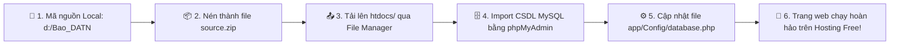

# SỔ TAY HƯỚNG DẪN THAO TÁC TỪNG BƯỚC: QUẢN TRỊ VIÊN HỆ THỐNG (ADMIN)
## Phân Hệ Quản Trị Hệ Thống, Ma Trận Phân Quyền RBAC, Cấu Hình SLA & Sao Lưu Dữ Liệu

---

## MỤC LỤC CHI TIẾT
1. [Đăng Nhập Quản Trị Viên & Khám Phá Trung Tâm Cấu Hình (Super-User)](#1-đăng-nhập-quản-trị-viên--khám-phá-trung-tâm-cấu-hình-super-user)
2. [Quản Trị Người Dùng, Cấp Phát Vai Trò & Đặt Lại Mật Khẩu (User Management)](#2-quản-trị-người-dùng-cấp-phát-vai-trò--đặt-lại-mật-khẩu-user-management)
3. [Thiết Lập Ma Trận Phân Quyền Vai Trò & Kiểm Soát Menu (RBAC Matrix)](#3-thiết-lập-ma-trận-phân-quyền-vai-trò--kiểm-soát-menu-rbac-matrix)
4. [Cấu Hình Danh Mục Sự Cố & Dịch Vụ Cổng Portal (Categories & Services)](#4-cấu-hình-danh-mục-sự-cố--dịch-vụ-cổng-portal-categories--services)
5. [Thiết Lập Nhóm IT Kỹ Thuật & Chính Sách Cam Kết SLA (IT Groups & SLA Policies)](#5-thiết-lập-nhóm-it-kỹ-thuật--chính-sách-cam-kết-sla-it-groups--sla-policies)
6. [Quản Trị, Soạn Thảo & Duyệt Xuất Bản Cơ Sở Tri Thức (KB Management)](#6-quản-trị-soạn-thảo--duyệt-xuất-bản-cơ-sở-tri-thức-kb-management)
7. [Trung Tâm Sao Lưu & Phục Hồi Dữ Liệu Phòng Chống Sự Cố (Backup & Disaster Recovery)](#7-trung-tâm-sao-lưu--phục-hồi-dữ-liệu-phòng-chống-sự-cố-backup--disaster-recovery)
8. [Hướng Dẫn Đóng Gói & Triển Khai Lên Máy Chủ Hosting Miễn Phí (Free Hosting Deployment)](#8-hướng-dẫn-đóng-gói--triển-khai-lên-máy-chủ-hosting-miễn-phí-free-hosting-deployment)

---

## 1. ĐĂNG NHẬP QUẢN TRỊ VIÊN & KHÁM PHÁ TRUNG TÂM CẤU HÌNH (SUPER-USER)

### Mục đích:
Đăng nhập với vai trò Quản trị viên tối cao (**Super-User**) có toàn quyền kiểm soát mọi phân hệ: Quản lý người dùng, phân bổ ma trận quyền hạn, cấu hình danh mục dịch vụ, quy tắc SLA, sao lưu cơ sở dữ liệu và giám sát an toàn hệ thống.

### Các bước thao tác bấm chuột:

#### Bước 1.1: Đăng nhập tài khoản Super-User
- Mở trình duyệt web truy cập: `http://localhost:3000/login`.
- Bấm chuột vào ô **"Tên đăng nhập"**: Nhập `admin`.
- Bấm chuột vào ô **"Mật khẩu"**: Nhập `123456`.
- Bấm chuột vào nút màu xanh **"ĐĂNG NHẬP HỆ THỐNG"**.
- **Kết quả:** Đăng nhập thành công với biểu tượng huy hiệu đỏ `ADMIN` trên thanh Topbar.

```text
GIAO DIỆN THANH TOPBAR VÀ WAFFLE MENU QUẢN TRỊ VIÊN (ADMIN)
+----------------------------------------------------------------------------------------------------+
| [::: Ứng dụng]  TaskFlow ITSM & Asset    [ 🔍 Tìm kiếm... ]           [🔔] [🌐 VI] [👤 Admin (ADMIN)]|
+----------------------------------------------------------------------------------------------------+
|  Menu Topbar: [ Dự Án ] [ Tickets ] [ Cổng Dịch Vụ ] [ Phê Duyệt ] [ Tài Sản ] [ Tri Thức ]        |
|  Menu Cấu Hình Quản Trị (Chỉ Admin thấy):                                                          |
|  [ 👥 Người Dùng ] [ 🛡️ Ma Trận RBAC ] [ 🏷️ Danh Mục/DV ] [ ⏱️ Nhóm/SLA ] [ 💾 Sao Lưu CSDL ]       |
+----------------------------------------------------------------------------------------------------+
```

#### Bước 1.2: Truy cập các phân hệ cấu hình quản trị
- Nhìn lên thanh Topbar phía trên hoặc bấm vào biểu tượng 9 dấu chấm **Waffle Menu [:::]** ở góc trên bên trái:
  - **Người Dùng (`/admin/users`):** Quản trị danh sách nhân viên và cấp phát vai trò.
  - **Ma Trận Phân Quyền (`/admin/permissions`):** Kiểm soát quyền xem menu và thực thi tác vụ.
  - **Danh Mục Sự Cố & Dịch Vụ (`/admin/categories`):** Thiết lập phân loại danh mục dịch vụ.
  - **Nhóm Kỹ Thuật & SLA (`/admin/groups`, `/admin/sla`):** Cấu hình đội ngũ IT và thời gian cam kết.
  - **Sao Lưu & Phục Hồi CSDL (`/admin/backups`):** Vận hành trung tâm chống thảm họa rủi ro dữ liệu.

---

## 2. QUẢN TRỊ NGƯỜI DÙNG, CẤP PHÁT VAI TRÒ & ĐẶT LẠI MẬT KHẨU (USER MANAGEMENT)

### Mục đích:
Khởi tạo tài khoản nhân viên mới, phân bổ vào các phòng ban nghiệp vụ (Kế toán, Kinh doanh, Marketing...), chỉ định vị trí chỗ ngồi làm việc, cấp phát vai trò phân quyền và đặt lại mật khẩu khi người dùng quên.

### Các bước thao tác bấm chuột:

#### Bước 2.1: Mở trang Quản lý Người dùng
- Truy cập menu **"Người Dùng"** hoặc link: `http://localhost:3000/admin/users`.
- Danh sách toàn bộ tài khoản trong hệ thống được hiển thị kèm phòng ban, chức vụ và huy hiệu vai trò.

```text
GIAO DIỆN QUẢN LÝ NGƯỜI DÙNG (USERS MANAGEMENT)
+----------------------------------------------------------------------------------------------------+
| 👥 QUẢN LÝ NGƯỜI DÙNG & PHÂN QUYỀN VAI TRÒ (RBAC)                  [ + Thêm Tài Khoản Mới ]        |
+----------------------------------------------------------------------------------------------------+
| ID  | HỌ VÀ TÊN        | TÀI KHOẢN & EMAIL            | PHÒNG BAN    | VAI TRÒ     | THAO TÁC      |
|-----+------------------+------------------------------+--------------+-------------+---------------|
| #1  | Administrator    | admin (admin@company.local)  | IT Core      | ⬛ ADMIN    | [Sửa] [Khóa]  |
| #2  | Trần Văn Hoàng   | manager (manager@comp.local) | Ban Giám Đốc | 🟦 MANAGER  | [Sửa] [Khóa]  |
| #3  | Lê Quốc Bảo      | it_helpdesk (bao.lq@...)     | IT Helpdesk  | 🔷 IT_STAFF | [Sửa] [Khóa]  |
| #6  | Đỗ Mai Phương    | user1 (phuong.dm@...)        | Marketing    | ⬜ USER     | [Sửa] [Khóa]  |
+----------------------------------------------------------------------------------------------------+
```

#### Bước 2.2: Thêm một tài khoản người dùng mới
1. Bấm chuột vào nút màu xanh **"+ Thêm Tài Khoản Mới"** (Icon `bi-person-plus-fill`).
2. Cửa sổ Modal hiện lên giữa màn hình:

```text
+-------------------------------------------------------------------------+
| THÊM TÀI KHOẢN NGƯỜI DÙNG MỚI                                       [X] |
|                                                                         |
| Họ và tên (*):                   Tên đăng nhập (Username) (*):          |
| [ Nguyễn Thị Mai Trang        ]  [ maitrang.kt                        ] |
|                                                                         |
| Địa chỉ Email (*):               Mật khẩu ban đầu (*):                  |
| [ maitrang@company.local      ]  [ 123456                             ] |
|                                                                         |
| Phòng ban (*):                   Vị trí chỗ ngồi / Máy lẻ:              |
| [ Phòng Kế Toán             ▼ ]  [ Bàn 08, Dãy B, Tầng 2              ] |
|                                                                         |
| Số điện thoại di động:           Vai trò hệ thống (Role) (*):           |
| [ 0912345678                  ]  [ USER (Người dùng cuối)             ▼]|
|                                                                         |
|                         [ Hủy ]    [ TẠO TÀI KHOẢN NGAY ]               |
+-------------------------------------------------------------------------+
```

3. Điền đầy đủ thông tin:
   - **Họ và tên:** Nhập tên đầy đủ (Ví dụ: `Nguyễn Thị Mai Trang`).
   - **Tên đăng nhập:** Viết liền không dấu (Ví dụ: `maitrang.kt`).
   - **Email:** Nhập email công ty.
   - **Mật khẩu ban đầu:** Đặt mật khẩu khởi tạo (Mặc định: `123456`).
   - **Phòng ban & Chỗ ngồi:** Chọn phòng ban và ghi rõ vị trí bàn để IT dễ tìm khi đến hỗ trợ tại chỗ.
   - **Vai trò:** Chọn một trong 4 vai trò: `USER`, `IT_STAFF`, `IT_MANAGER`, hoặc `ADMIN`.
4. Bấm nút màu xanh **"TẠO TÀI KHOẢN NGAY"**.
5. **Kết quả:** Tài khoản được tạo thành công, xuất hiện thông báo xanh *"Đã thêm tài khoản thành công!"*.

#### Bước 2.3: Đặt lại mật khẩu & Khóa tài khoản
- **Khi nhân viên quên mật khẩu:** Bấm nút **"Sửa"** tại dòng nhân viên > Nhập mật khẩu mới vào ô "Đổi mật khẩu" > Bấm **"Lưu Thay Đổi"**.
- **Khi nhân viên nghỉ việc:** Bấm nút màu đỏ **"Khóa"**. Tài khoản sẽ bị vô hiệu hóa ngay lập tức và không thể đăng nhập vào hệ thống.

---

## 3. THIẾT LẬP MA TRẬN PHÂN QUYỀN VAI TRÒ & KIỂM SOÁT MENU (RBAC MATRIX)

### Mục đích & Cơ chế kiểm soát:
Quản trị ma trận phân quyền dựa trên vai trò (**Role-Based Access Control**). Admin có thể cấu hình chi tiết cho 4 vai trò (`ADMIN`, `IT_MANAGER`, `IT_STAFF`, `USER`) với 22 quyền hạn khác nhau. 
- **Cơ chế Ẩn Hiện Menu Tự Động:** Nếu một vai trò bị gỡ quyền menu (Ví dụ: gỡ `menu.assets` khỏi `USER`), thanh điều hướng Topbar và Waffle menu của người dùng đó sẽ **ẩn hoàn toàn**, không để lại dấu vết.
- **Bảo Vệ Tầng Controller (Zero-Trust):** Dù người dùng cố tình gõ link trực tiếp trên thanh địa chỉ duyệt web (Ví dụ: `http://localhost:3000/assets`), bộ lọc Middleware của hệ thống sẽ chặn đứng và báo lỗi *403 Forbidden - Bạn không có quyền truy cập trang này*.

### Các bước thao tác bấm chuột:

#### Bước 3.1: Truy cập Ma Trận Phân Quyền
- Bấm vào menu **"Ma Trận RBAC"** hoặc truy cập: `http://localhost:3000/admin/permissions`.
- Màn hình hiển thị bảng ma trận lưới kiểm soát tất cả phân hệ.

```text
GIAO DIỆN MA TRẬN PHÂN QUYỀN VAI TRÒ & MENU HỆ THỐNG
+----------------------------------------------------------------------------------------------------+
| 🛡️ MA TRẬN PHÂN QUYỀN VAI TRÒ & MENU HỆ THỐNG                     [ 💾 LƯU THIẾT LẬP MA TRẬN ]      |
| [ 🔍 Tìm kiếm chức năng / mã quyền...              ]                                               |
+----------------------------------------------------------------------------------------------------+
| CHỨC NĂNG / QUYỀN HẠN HỆ THỐNG            | ADMIN   | IT_MANAGER | IT_STAFF | USER (END-USER)     |
|                                           | [Tất|Bỏ]|  [Tất|Bỏ]  | [Tất|Bỏ] |    [Tất|Bỏ]         |
|-------------------------------------------+---------+------------+----------+---------------------|
| 📁 [1] DỰ ÁN JIRA & CÔNG VIỆC (PROJECTS)  |         |            |          |                     |
|  - Truy cập Menu Dự Án (menu.projects)    |   [x]   |    [x]     |   [x]    |       [x]           |
|  - Tạo dự án mới (projects.create)        |   [x]   |    [x]     |   [ ]    |       [ ]           |
|                                           |         |            |          |                     |
| 🎫 [2] PHIẾU HỖ TRỢ KỸ THUẬT (TICKETS)    |         |            |          |                     |
|  - Truy cập Menu Tickets (menu.tickets)   |   [x]   |    [x]     |   [x]    |       [x]           |
|  - Xem Hàng đợi Chưa gán (unassigned)     |   [x]   |    [x]     |   [ ]    |       [ ]           |
|  - Điều chỉnh SLA Priority (rule 9)       |   [x]   |    [x]     |   [ ]    |       [ ]           |
|                                           |         |            |          |                     |
| 💻 [3] QUẢN LÝ TÀI SẢN CNTT (ASSETS)      |         |            |          |                     |
|  - Truy cập Menu Tài Sản (menu.assets)    |   [x]   |    [x]     |   [x]    |       [ ] ❌ Ẩn Menu|
|  - Bàn giao & Thu hồi (assets.manage)     |   [x]   |    [x]     |   [x]    |       [ ]           |
|                                           |         |            |          |                     |
| 📥 [4] XUẤT DỮ LIỆU BÁO CÁO (EXPORT)      |         |            |          |                     |
|  - Nút Xuất Excel Tickets (export.tickets)|   [x]   |    [x]     |   [x]    |       [ ] ❌ Ẩn Nút |
|  - Nút Xuất Excel Assets (export.assets)  |   [x]   |    [x]     |   [x]    |       [ ] ❌ Ẩn Nút |
+----------------------------------------------------------------------------------------------------+
```

#### Bước 3.2: Thao tác bật/tắt quyền và Lưu ma trận
1. **Tìm kiếm nhanh quyền:** Gõ từ khóa vào ô tìm kiếm (Ví dụ: gõ `export` hoặc `assets`) để lọc nhanh các dòng quyền liên quan.
2. **Chọn nhanh theo cột:** Bấm nút **"Chọn hết"** hoặc **"Bỏ chọn"** ở tiêu đề từng cột vai trò nếu muốn cấp hoặc thu hồi hàng loạt.
3. **Tích chọn / Bỏ chọn từng ô checkbox:**
   - Để ẩn menu Tài sản khỏi người dùng thường: Bỏ tích checkbox dòng `menu.assets` tại cột `USER`.
   - Để chỉ cho phép Manager điều chỉnh mức ưu tiên phiếu: Đảm bảo chỉ có cột `ADMIN` và `IT_MANAGER` có dấu tích ở dòng `tickets.adjust_priority`.
4. **Lưu thiết lập:** Bấm nút màu xanh **"LƯU THIẾT LẬP MA TRẬN"** (Icon `bi-check2-circle`) ở góc trên bên phải trang.
5. **Kết quả:** Hệ thống lưu cấu hình tức thì vào CSDL, mọi thay đổi áp dụng ngay lập tức mà không cần khởi động lại máy chủ web.

---

## 4. CẤU HÌNH DANH MỤC SỰ CỐ & DỊCH VỤ CỔNG PORTAL (CATEGORIES & SERVICES)

### Mục đích:
Tạo cây phân cấp danh mục dịch vụ: Danh mục cấp 1 (Categories) và Dịch vụ chi tiết cấp 2 (Service Catalog) để người dùng chọn khi báo hỏng hoặc đăng ký tài nguyên.

### Các bước thao tác bấm chuột:

#### Bước 4.1: Mở trang cấu hình Danh mục & Dịch vụ
- Truy cập menu **"Danh Mục/DV"** hoặc link: `http://localhost:3000/admin/categories`.
- Màn hình chia làm 2 cột: Cột trái là **Danh Mục Sự Cố Cấp 1**, Cột phải là **Dịch Vụ Chi Tiết Cấp 2**.

```text
GIAO DIỆN CẤU HÌNH DANH MỤC CẤP 1 VÀ DỊCH VỤ CẤP 2
+----------------------------------------------------------------------------------------------------+
| 🏷️ CẤU HÌNH DANH MỤC & DỊCH VỤ IT           [ + Thêm Danh Mục Cấp 1 ]  [ + Thêm Dịch Vụ Cấp 2 ]    |
+----------------------------------------------------------------------------------------------------+
| CỘT TRÁI: DANH MỤC SỰ CỐ CẤP 1 (4 Danh mục)       | CỘT PHẢI: DỊCH VỤ CẤP 2 (16 Dịch vụ)           |
| Tên Danh Mục     | Mã Code | Nhóm IT mặc định     | Tên Dịch Vụ Cấp 2      | Danh Mục | SLA Gán | Duyệt|
|------------------+---------+----------------------|------------------------+----------+---------+------|
| Hạ Tầng Mạng     | NETWORK | Mạng & Hạ Tầng       | Mất kết nối mạng LAN   | NETWORK  | 2 Giờ   | Không|
| Máy Trạm & Cứng  | HARDWARE| Phần Cứng & Trạm     | Cấp mới Laptop Dell    | HARDWARE | 24 Giờ  | CÓ ✍️|
| Phần Mềm & ERP   | SOFTWARE| Phần Mềm & ERP       | Cài đặt Microsoft 365  | SOFTWARE | 4 Giờ   | Không|
+----------------------------------------------------------------------------------------------------+
```

#### Bước 4.2: Thêm một Dịch vụ mới lên Cổng Dịch Vụ (Service Catalog)
1. Bấm nút màu xanh lá **"+ Thêm Dịch Vụ Cấp 2"** (Icon `bi-plus-circle`).
2. Cửa sổ Modal hiện lên:
   - **Thuộc danh mục cấp 1 (*):** Chọn danh mục cha (Ví dụ: `Máy Trạm & Phần Cứng`).
   - **Tên dịch vụ (*):** Nhập tên dịch vụ (Ví dụ: `Cấp phát Màn hình đồ họa Dell UltraSharp 27 inch`).
   - **Mã dịch vụ (Code):** Nhập mã viết hoa (Ví dụ: `REQ_MONITOR_27`).
   - **Nhóm IT thực hiện:** Chọn nhóm kỹ thuật chịu trách nhiệm (Ví dụ: `Phần Cứng & Trạm`).
   - **Dự toán chi phí (VNĐ):** Nhập số tiền (Ví dụ: `9,500,000`).
   - **Yêu cầu phê duyệt (Requires Approval):** Tích chọn ô này nếu cần Trưởng phòng hoặc IT Manager duyệt trước khi bàn giao.
3. Bấm **"Lưu Dịch Vụ"**.
4. **Kết quả:** Dịch vụ mới lập tức hiển thị trên Cổng Dịch Vụ của nhân viên tại `http://localhost:3000/catalog`.

---

## 5. THIẾT LẬP NHÓM IT KỸ THUẬT & CHÍNH SÁCH CAM KẾT SLA (IT GROUPS & SLA POLICIES)

### Mục đích:
Định nghĩa các nhóm hỗ trợ kỹ thuật chuyên trách và thiết lập thời hạn cam kết chất lượng dịch vụ (SLA) theo chuẩn ITIL Service Level Management.

### Các bước thao tác bấm chuột:

#### Bước 5.1: Cấu hình Nhóm Kỹ Thuật (IT Groups)
- Truy cập menu **"Nhóm IT"** hoặc link: `http://localhost:3000/admin/groups`.
- Bấm **"+ Thêm Nhóm Mới"** để tạo nhóm kỹ thuật mới (Ví dụ: *An Toàn Thông Tin - SOC/SecOps*).
- Gán nhân viên kỹ thuật vào nhóm và chỉ định Trưởng nhóm (Leader) phụ trách tiếp nhận phiếu.

#### Bước 5.2: Cấu hình Chính Sách Cam Kết SLA (SLA Policies)
- Truy cập menu **"Chính Sách SLA"** hoặc link: `http://localhost:3000/admin/sla`.
- Bảng chính sách SLA chuẩn của hệ thống:

```text
GIAO DIỆN CHÍNH SÁCH CAM KẾT CHẤT LƯỢNG DỊCH VỤ (SLA MATRIX)
+----------------------------------------------------------------------------------------------------+
| MỨC ĐỘ ƯU TIÊN | THỜI GIAN PHẢN HỒI (FIRST RESPONSE) | THỜI GIAN GIẢI QUYẾT (RESOLUTION) | MÀU HIỂN THỊ|
|----------------+-------------------------------------+-----------------------------------+-------------|
| 🔴 URGENT      | 15 Phút                             | 2 Giờ                             | Đỏ rực rỡ   |
| 🟠 HIGH        | 1 Giờ                               | 8 Giờ (1 Ngày làm việc)           | Cam đậm     |
| 🟡 NORMAL      | 4 Giờ                               | 24 Giờ (3 Ngày làm việc)          | Vàng tươi   |
| 🔵 LOW         | 8 Giờ                               | 48 Giờ (6 Ngày làm việc)          | Xanh dương  |
+----------------------------------------------------------------------------------------------------+
```

- Bấm nút **"Sửa"** tại từng mức để điều chỉnh số giờ phản hồi và giải quyết phù hợp với quy mô thực tế của doanh nghiệp > Bấm **"Cập Nhật SLA"**.

---

## 6. QUẢN TRỊ, SOẠN THẢO & DUYỆT XUẤT BẢN CƠ SỞ TRI THỨC (KB MANAGEMENT)

### Mục đích:
Biên tập và xuất bản các bài viết hướng dẫn kỹ thuật để người dùng tự khắc phục lỗi và cung cấp dữ liệu tri thức thông minh cho trợ lý AI Chatbot Popup.

### Các bước thao tác bấm chuột:

#### Bước 6.1: Mở trang Quản trị Tri thức
- Truy cập menu **"Tri Thức"** > Bấm nút **"Quản Lý Bài Viết"** hoặc truy cập: `http://localhost:3000/kb/manage`.
- Màn hình hiển thị danh sách toàn bộ bài viết hướng dẫn đã xuất bản (`PUBLISHED`) hoặc đang soạn thảo (`DRAFT`).

#### Bước 6.2: Soạn thảo bài viết mới
1. Bấm nút màu xanh **"+ Viết Bài Mới"** (URL: `http://localhost:3000/kb/create`).
2. Nhập tiêu đề bài viết rõ ràng (Ví dụ: *Hướng dẫn cài đặt máy in mạng Canon qua địa chỉ IP nội bộ*).
3. Chọn chuyên mục: *Phần Cứng, Mạng LAN, Phần Mềm Văn Phòng, An Toàn Thông Tin*.
4. **Nội dung hướng dẫn chi tiết:** Nhập từng bước thao tác, dán ảnh chụp màn hình minh họa.
5. **Trạng thái xuất bản:** Chọn `PUBLISHED` để người dùng và AI Chatbot có thể tra cứu ngay.
6. Bấm nút màu xanh **"Xuất Bản Bài Viết"**.

---

## 7. TRUNG TÂM SAO LƯU & PHỤC HỒI DỮ LIỆU PHÒNG CHỐNG SỰ CỐ (BACKUP & DISASTER RECOVERY)

### Mục đích & Đột phá kỹ thuật:
Bảo vệ an toàn dữ liệu 100% trước nguy cơ virus tống tiền (Ransomware), lỗi ổ cứng hoặc nhân viên thao tác nhầm. Hệ thống sử dụng **công cụ sao lưu thuần PHP PDO độc quyền**, hoàn toàn không phụ thuộc vào tiện ích ngoài hệ điều hành `mysqldump`, hoạt động trơn tru trên cả máy tính Windows localhost và mọi máy chủ hosting Linux cPanel.

### Các bước thao tác bấm chuột:

#### Bước 7.1: Mở Trung Tâm Sao Lưu & Phục Hồi
- Bấm vào menu **"Sao Lưu CSDL"** trên thanh Topbar hoặc truy cập: `http://localhost:3000/admin/backups`.
- Màn hình hiển thị 3 thẻ thống kê: Tổng số bản sao lưu snapshot, dung lượng lưu trữ, và danh sách các tệp `.sql` hiện có.

```text
GIAO DIỆN TRUNG TÂM SAO LƯU & PHỤC HỒI CSDL (DISASTER RECOVERY)
+----------------------------------------------------------------------------------------------------+
| 💾 TRUNG TÂM SAO LƯU & PHỤC HỒI DỮ LIỆU CSDL                    [ ☁️ TẠO BẢN SAO LƯU NGAY ]         |
| Tạo bản chụp MySQL tức thì (Schema & Dữ liệu), tải về lưu trữ an toàn hoặc khôi phục sự cố         |
+----------------------------------------------------------------------------------------------------+
|  [ TỔNG BẢN SAO LƯU ]            [ DUNG LƯỢNG LƯU TRỮ ]            [ TRẠNG THÁI PHÒNG NGỪA ]       |
|      3 Snapshots                       4.85 MB                       🟢 Sẵn sàng khôi phục         |
+----------------------------------------------------------------------------------------------------+
| TÊN TỆP SAO LƯU (.sql)                 | DUNG LƯỢNG | THỜI ĐIỂM TẠO      | THAO TÁC                |
|----------------------------------------+------------+--------------------+-------------------------|
| backup_2026-09-26_11-00-00_truoc_up.sql| 1.62 MB    | 26/09/2026 11:00:00| [Tải về][Khôi phục][🗑️] |
| backup_2026-09-25_17-30-00_dinh_ky.sql | 1.60 MB    | 25/09/2026 17:30:00| [Tải về][Khôi phục][🗑️] |
| backup_2026-09-24_08-15-00_khoi_tao.sql| 1.58 MB    | 24/09/2026 08:15:00| [Tải về][Khôi phục][🗑️] |
+----------------------------------------------------------------------------------------------------+
```

#### Bước 7.2: Tạo một bản sao lưu tức thì (Create Snapshot)
1. Bấm chuột vào nút màu xanh **"☁️ Tạo Bản Sao Lưu Ngay"** (Icon `bi-cloud-arrow-up-fill`).
2. Cửa sổ Modal bật lên:
   - **Ghi chú hoặc nhãn nhận diện (Tùy chọn):** Nhập mục đích sao lưu (Ví dụ: `truoc_khi_cap_nhat_phong_ban`). Nhãn này sẽ được tự động gắn vào tên file.
3. Bấm nút màu xanh **"Bắt đầu sao lưu"**.
4. **Kết quả:** Hệ thống quét toàn bộ cấu trúc bảng (DDL) và dữ liệu (DML), tạo file `.sql` hoàn chỉnh trong thư mục `storage/backups/` và hiển thị thông báo thành công trong 1-2 giây.

#### Bước 7.3: Tải file sao lưu về máy tính cá nhân
- Tại dòng của bản sao lưu, bấm nút **"Tải về"** (Icon `bi-download`).
- Trình duyệt sẽ tải tệp `.sql` về thư mục Downloads của bạn. Admin có thể sao chép file này lưu trữ lên Google Drive hoặc ổ cứng ngoài USB để lưu trữ an toàn ngoại vi.

#### Bước 7.4: Quy trình Khôi Phục Dữ Liệu Khi Gặp Sự Cố (Disaster Recovery Restore)
1. Xác định bản sao lưu có dữ liệu toàn vẹn trước thời điểm xảy ra sự cố.
2. Bấm chuột vào nút màu vàng **"Khôi phục"** (Icon mũi tên tròn `bi-arrow-counterclockwise`).
3. Cửa sổ hộp thoại cảnh báo bảo mật xuất hiện:
   > *"CẢNH BÁO QUAN TRỌNG: Bạn sắp khôi phục cơ sở dữ liệu từ file backup. Toàn bộ dữ liệu hiện tại sẽ bị ghi đè hoàn toàn. Bạn có chắc chắn 100% muốn thực hiện không?"*
4. Bấm **OK** để xác nhận.
5. **Cơ chế vận hành:** Hệ thống tự động thiết lập `SET FOREIGN_KEY_CHECKS=0`, xóa và tái tạo lại toàn bộ bảng, sau đó bơm lại đầy đủ 100% dữ liệu gốc của thời điểm sao lưu. Trang web tự động tải lại và dữ liệu được khôi phục nguyên vẹn.

---

## 8. HƯỚNG DẪN ĐÓNG GÓI & TRIỂN KHAI LÊN MÁY CHỦ HOSTING MIỄN PHÍ (FREE HOSTING DEPLOYMENT)

### Mục đích:
Đưa toàn bộ dự án TaskFlow ITSM lên chạy trên các nhà cung cấp Web Hosting miễn phí (như **InfinityFree**, **000webhost**, **AwardSpace**) hoặc hosting doanh nghiệp có cPanel / DirectAdmin mà không gặp bất kỳ lỗi trắng trang, lỗi đường dẫn 404 hay lỗi quyền truy cập.



### Các bước thao tác bấm chuột chi tiết:

#### Bước 8.1: Nén mã nguồn dự án
1. Mở thư mục dự án `d:\Bao_DATN` trên máy tính của bạn.
2. Chọn toàn bộ tất cả các tệp và thư mục con (Đảm bảo bao gồm cả file cấu hình điều hướng ẩn [`.htaccess`](file:///d:/Bao_DATN/.htaccess) ở thư mục gốc).
3. Nhấp chuột phải > Chọn **Compress to ZIP file** (Nén thành tệp `source.zip`).

#### Bước 8.2: Tải lên và giải nén trên File Manager của Hosting
1. Đăng nhập vào trang quản trị của nhà cung cấp hosting (Ví dụ: InfinityFree cPanel).
2. Bấm vào biểu tượng **Online File Manager**.
3. Mở thư mục gốc chạy web là **`htdocs/`** (hoặc `public_html/`).
4. Bấm nút **Upload** và chọn tải tệp `source.zip` lên.
5. Nhấp chuột phải vào file `source.zip` vừa tải lên > Bấm chọn **Extract (Giải nén)**.

#### Bước 8.3: Tạo CSDL MySQL và Import dữ liệu
1. Trên trang quản trị cPanel của hosting, tìm đến mục **MySQL Databases**:
   - Nhập tên CSDL mới > Bấm **Create Database** (Ví dụ: `epiz_312456_taskflow`).
   - Ghi lại các thông số: MySQL Hostname, MySQL Database Name, MySQL Username, và Password.
2. Mở công cụ quản lý cơ sở dữ liệu **phpMyAdmin** trên hosting:
   - Bấm chọn tên CSDL vừa tạo ở cột bên trái.
   - Bấm vào tab **Import** trên thanh menu đầu trang.
   - Bấm **Choose File (Chọn tệp)**: Chọn file sao lưu mới nhất trong thư mục `storage/backups/` hoặc file `database/schema_phase1.sql`.
   - Cuộn xuống dưới cùng và bấm nút **Go (Thực hiện)**.
   - **Kết quả:** phpMyAdmin báo thông báo xanh *"Import has been successfully finished"*.

#### Bước 8.4: Cấu hình kết nối CSDL trong mã nguồn
1. Mở lại File Manager trên hosting, duyệt vào đường dẫn: `htdocs/app/Config/database.php`.
2. Nhấp chuột phải vào file `database.php` > Chọn **Edit**.
3. Sửa lại các thông số kết nối khớp với hosting:
   ```php
   'host'     => 'sqlxxx.infinityfree.com', // Điền MySQL Hostname của hosting
   'database' => 'epiz_312456_taskflow',    // Điền tên Database của hosting
   'username' => 'epiz_312456',             // Điền Username hosting
   'password' => 'MatKhauCuaBan',          // Điền Password CSDL
   ```
4. Bấm **Save & Close**.

#### Bước 8.5: Các đặc tính tương thích vượt trội đã được tối ưu sẵn trong dự án:
- ✅ **Điều hướng `.htaccess` 2 lớp:** File `.htaccess` ở thư mục gốc tự động nhận diện môi trường hosting shared không có quyền chỉnh VirtualHost, tự động route mọi request vào `public/index.php` mượt mà.
- ✅ **Bộ thư viện xem file Offline 100%:** Thư viện xem Word [mammoth.browser.min.js](file:///d:/Bao_DATN/public/js/mammoth.browser.min.js) và xem Excel [xlsx.full.min.js](file:///d:/Bao_DATN/public/js/xlsx.full.min.js) đã được lưu trữ cục bộ trong thư mục `public/js/`, không phụ thuộc vào internet ngoài nên hoạt động trơn tru ngay cả khi hosting miễn phí chặn kết nối cURL ra ngoài.
- ✅ **Phân quyền thư mục ghi file:** Chỉ cần đảm bảo 2 thư mục `storage/backups/` và `public/uploads/` được cấp quyền ghi (`chmod 777` hoặc `755` trên hosting) là tính năng đính kèm tệp và sao lưu dữ liệu hoạt động hoàn hảo.

---

> [!IMPORTANT]
> **Quy Tắc Vàng Dành Cho Quản Trị Viên (System Administrator):**
> - **Nguyên tắc an toàn trước khi cập nhật:** Luôn truy cập vào `http://localhost:3000/admin/backups` và bấm **"Tạo Bản Sao Lưu Ngay"** trước bất kỳ thao tác nâng cấp mã nguồn hoặc thay đổi cấu hình quan trọng nào.
> - **Tài khoản khẩn cấp:** Không bao giờ khóa hoặc hạ quyền của tài khoản `admin` để đảm bảo luôn có ít nhất một Super-User cứu hộ hệ thống.
