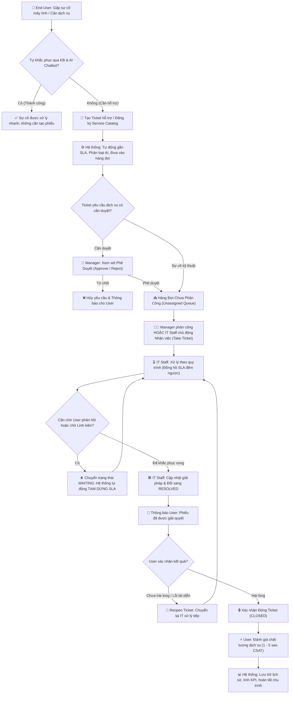

# TASKFLOW IT SERVICE DESK & ASSET MANAGEMENT
## CẨM NANG HƯỚNG DẪN SỬ DỤNG HỆ THỐNG TOÀN TẬP
*(Dành cho tất cả đối tượng: End-User, IT Staff, IT Manager, Admin)*

---

## 1. GIỚI THIỆU CHUNG HỆ THỐNG

**TaskFlow IT Service Desk & Asset Management** là hệ thống quản lý dịch vụ công nghệ thông tin (ITSM) và quản trị dự án công việc kỹ thuật (Agile/Jira style) toàn diện theo chuẩn quốc tế **ITIL v4**. Hệ thống phục vụ toàn bộ chu trình xử lý yêu cầu kỹ thuật, vận hành tài sản CNTT, kiểm soát SLA và phối hợp nhóm trong doanh nghiệp.

### Các Phân Hệ Cốt Lõi:
1. **IT Service Desk (Quản lý Phiếu hỗ trợ & Sự cố)**: Tiếp nhận, phân loại thông minh (AI Triage), đo lường thời gian thực SLA Live Timer, phân nhóm IT, xử lý và đánh giá hài lòng (CSAT).
2. **Service Catalog (Cổng Danh Mục Dịch Vụ)**: Cho phép cán bộ nhân viên tự phục vụ (Self-service Portal) gửi yêu cầu cấp thiết bị, phần mềm, quyền truy cập.
3. **Agile Project Management (Quản lý Dự Án & Công Việc Jira Style)**: Lập kế hoạch Backlog, quản trị phân cấp cha-con (Backlog -> Task/Bug -> TestCase), bảng Kanban kéo thả, ước lượng thời gian (Effort Estimation).
4. **IT Asset Management - ITAM (Quản lý Tài Sản CNTT)**: Quản lý vòng đời phần cứng máy tính, bàn giao thiết bị, bảo hành, sửa chữa và liên kết trực tiếp với phiếu sự cố.
5. **Knowledge Base & AI Chatbot (Cơ Sở Tri Thức & Trợ Lý Kỹ Thuật 24/7)**: Kho bài viết giải pháp tự khắc phục lỗi và AI Chatbot popup đính góc trái dưới hỗ trợ giải đáp kỹ thuật tức thì.
6. **Approval Workflow Center (Trung Tâm Phê Duyệt)**: Quy trình ký duyệt yêu cầu dịch vụ nhiều cấp trước khi IT triển khai.
7. **Role-Based Access Control - RBAC (Ma Trận Phân Quyền)**: Bật/tắt linh hoạt các menu và hành động theo từng vai trò.
8. **Backup & Disaster Recovery (Sao Lưu & Phục Hồi CSDL)**: Tạo snapshot tức thì, tải về file `.sql` và phục hồi an toàn khi có sự cố.

---

## 2. BẢNG DANH MỤC TÀI LIỆU HƯỚNG DẪN THEO VAI TRÒ

| Tài Liệu Hướng Dẫn | Đối Tượng Sử Dụng | Nội Dung Trọng Tâm |
| :--- | :--- | :--- |
| **[01. Hướng Dẫn Người Dùng Cuối (End-User)](./01_HUONG_DAN_ENDUSER.md)** | Cán bộ nhân viên các phòng ban (Kế toán, Kinh doanh, Marketing, Nhân sự...) | Tạo ticket hỗ trợ, tra cứu Service Catalog, theo dõi tiến độ, trao đổi với IT, xem trước trực tiếp file đính kèm (Word/Excel/PDF), đánh giá dịch vụ, chat hỏi AI kỹ thuật. |
| **[02. Hướng Dẫn Kỹ Thuật Viên IT (IT Staff)](./02_HUONG_DAN_IT_STAFF.md)** | Chuyên viên Helpdesk, Kỹ thuật viên IT, Network/System Admin | Tiếp nhận ticket (Take ticket), quản lý hàng đợi cá nhân, Kanban Board, kiểm soát SLA Live Timer, ghi chú nội bộ, trợ lý AI Copilot, quản lý tài sản ITAM, đóng phiếu chuẩn ITIL. |
| **[03. Hướng Dẫn Quản Lý IT (IT Manager)](./03_HUONG_DAN_IT_MANAGER.md)** | IT Leader, IT Manager, Trưởng bộ phận kỹ thuật | Dashboard chỉ số KPI & SLA, phân bổ tải nhóm (Group Workload), duyệt yêu cầu dịch vụ, điều chỉnh mức độ ưu tiên, quản lý dự án Agile & Sprint Backlog, xuất báo cáo Excel. |
| **[04. Hướng Dẫn Quản Trị Viên (Admin)](./04_HUONG_DAN_ADMIN.md)** | Quản trị viên hệ thống (System Administrator) | Quản lý người dùng & phòng ban, cấu hình Ma trận phân quyền (RBAC Matrix), thiết lập SLA Policies, quản trị kho tri thức, sao lưu & phục hồi CSDL (Disaster Recovery), cấu hình Free Hosting. |

---

## 3. DANH SÁCH TÀI KHOẢN MẪU ĐỂ ĐĂNG NHẬP VÀ KIỂM THỬ

Hệ thống đã được thiết lập sẵn bộ dữ liệu tài khoản đại diện cho các phòng ban và vai trò:

| Tên Đăng Nhập | Mật Khẩu | Họ Và Tên | Vai Trò (Role) | Chức Vụ / Phòng Ban |
| :--- | :---: | :--- | :--- | :--- |
| `admin` | `123456` | Administrator | **ADMIN** | Quản Trị Viên Hệ Thống |
| `manager` | `123456` | Trần Văn Hoàng | **IT_MANAGER** | Trưởng Phòng IT / Leader |
| `it_helpdesk` | `123456` | Lê Quốc Bảo | **IT_STAFF** | Chuyên viên Helpdesk Lầu 2 |
| `it_network` | `123456` | Nguyễn Minh Trí | **IT_STAFF** | Kỹ sư Mạng & Hệ thống |
| `user1` | `123456` | Đỗ Mai Phương | **USER** | Nhân viên Marketing |
| `ketoan_lan` | `123456` | Nguyễn Thị Lan | **USER** | Kế toán viên - Phòng Kế Toán |
| `kinhdoanh_nam`| `123456` | Hoàng Hoài Nam | **USER** | Nhân viên Kinh Doanh |

---

## 4. SƠ ĐỒ LUỒNG CHẠY TỔNG THỂ CỦA MỘT YÊU CẦU DỊCH VỤ

---

*Hệ thống được đóng gói hoàn chỉnh, sẵn sàng vận hành trên môi trường phát triển cục bộ và triển khai trực tiếp lên máy chủ Web Hosting.*
